# Диаграммы модуля SCHEDULER.py

> Ответственный: Тимур (Scheduler) | Проверено по коду: `6c0aae2` (ветка `dev`)  
> Все схемы соответствуют коммиту `6c0aae2`; поведение подтверждено чтением кода и фактическими прогонами (сценарий TTI 5 из [README §4](../README.md), pytest). Наблюдения, упомянутые на схемах (BUG/OPT/DOC-SCH-xxx), — в [audit.md](audit.md); планируемые изменения (FEAT/OPT-SCH-xxx) — в [features.md](features.md). В метках переходов диаграмм состояний строки кода указаны как «стр. NNN»: второе двоеточие в метке перехода синтаксис Mermaid не допускает.

## 1. Текущая структура (AS-IS)

Кратко: показаны границы модуля, его внутренний состав и структура классов; каждое соединение подтверждено кодом (ссылки в §4) и прогоном сценария TTI 5.

### 1.1. Контекст модуля: границы и побочные эффекты

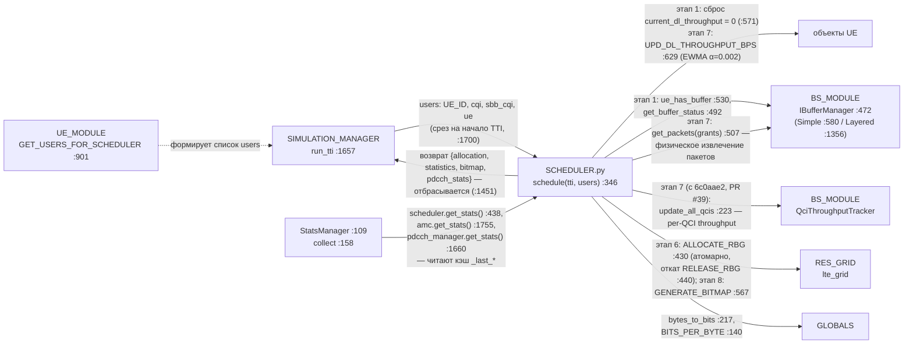

### 1.2. Внутренний состав модуля

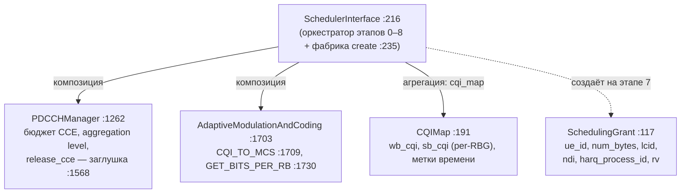

### 1.3. UML классов

```mermaid
classDiagram
    class SchedulerInterface {
        +lte_grid
        +amc
        +pdcch_manager
        +cqi_map
        +create(algorithm, lte_grid, bs)
        +schedule(tti, users) Dict
        +get_stats() Dict
        #_refresh_cqi()
        #_filter_eligible_ues()
        #_update_active_window()
        #filter_by_window()
        #_form_priority_list()
        #_apply_pdsch_estimation()
        #_allocate_pdcch()
        #_logical_channel_multiplexing()
        #_process_buffers()
        #_calculate_priorities()*
        #_allocate_pdsch()*
    }
    class BestCQIScheduler {
        #_calculate_priorities() priority = WB CQI
        #_allocate_pdsch() жадный TD
    }
    class RoundRobinScheduler {
        +rr_rbg_offset
        +rr_ue_offset
        #_calculate_priorities() ротация очереди
        #_apply_pdsch_estimation() pass-through
        #_allocate_pdsch() 1 RBG по кругу
    }
    class ProportionalFairScheduler {
        #_calculate_priorities() r/R
        #_allocate_pdsch() жадный TD
    }
    class FDxBestCQIScheduler {
        #_allocate_pdsch() per-RBG max SB CQI
    }
    class FDxFairGreedyScheduler {
        +rr_rbg_offset
        +rr_ue_offset
        #_allocate_pdsch() per-RBG + served_in_round
    }
    class FDxProportionalFairScheduler {
        #_allocate_pdsch() per-RBG PF по SB CQI
    }
    class BasicQosAwareScheduler {
        +metric_mode (Coita/PF)
        #_calculate_priorities() HOL×GBR×CQA
        #_apply_pdsch_estimation() pass-through
        #_allocate_pdsch() per-RBG по QoS-метрике
    }
    class QosAwareScheduler {
        +allocation_flow
        #_calculate_priorities() per-flow GBR/urgency
        #_apply_pdsch_estimation() pass-through
        #_allocate_pdsch() per-RBG выбор потока
    }
    class PDCCHManager {
        +total_cce
        +max_dl_cce
        +num_assigned_cce
        +get_aggregation_level(cqi)
        +allocate_cce(ue_id, n)
        +reset_tti()
        +release_cce(ue_id) заглушка
        +get_stats()
    }
    class AdaptiveModulationAndCoding {
        +CQI_TO_MCS
        +GET_BITS_PER_RB(cqi)
        +get_stats()
    }
    class CQIMap {
        +wb_cqi
        +sb_cqi
        +last_wb_update
        +last_sb_update
    }
    class SchedulingGrant {
        +ue_id
        +num_bytes
        +lcid
        +ndi
        +rv
        +to_dict()
    }
    SchedulerInterface <|-- BestCQIScheduler
    SchedulerInterface <|-- RoundRobinScheduler
    SchedulerInterface <|-- ProportionalFairScheduler
    SchedulerInterface <|-- FDxBestCQIScheduler
    SchedulerInterface <|-- FDxFairGreedyScheduler
    SchedulerInterface <|-- FDxProportionalFairScheduler
    SchedulerInterface <|-- BasicQosAwareScheduler
    SchedulerInterface <|-- QosAwareScheduler
    SchedulerInterface *-- PDCCHManager
    SchedulerInterface *-- AdaptiveModulationAndCoding
    SchedulerInterface o-- CQIMap : cqi_map
    SchedulerInterface ..> SchedulingGrant : создаёт на этапе 7
```

## 2. Типовой сценарий (AS-IS)

Сценарий: один TTI — вызов `schedule(tti, users)` из `SIMULATION_MANAGER.run_tti()`, включая все выходы за границы модуля. Порядок этапов подтверждён кодом :346–436 и прогоном ([README §4](../README.md)).

### 2.1. Последовательность вызовов

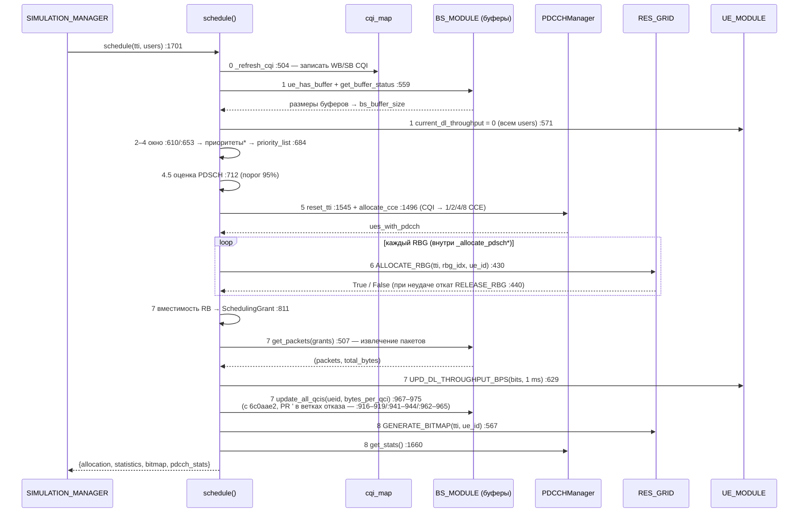

Звёздочкой помечены виртуальные методы — точки расхождения восьми алгоритмов (`_calculate_priorities` :1172, `_allocate_pdsch` :1197); третья точка расхождения — переопределения `_apply_pdsch_estimation` (:712).

### 2.2. Досрочные выходы (dataflow с ветвлениями)

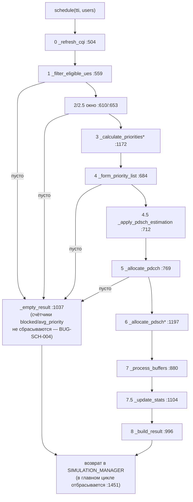

### 2.3. Контур обратной связи между TTI

Проверен замером на `ae9db40`: заранее выставленный `average_throughput` = 1 000 000 у незапланированного UE затухает до 996 004 за один TTI — двойной нулевой шаг EWMA ([BUG-SCH-001](audit.md#bug-sch-001)). На `6c0aae2` (PR #39) ветка получила `continue` (:919) — шаг один: 998 000; контур обратной связи ниже сохраняет смысл.

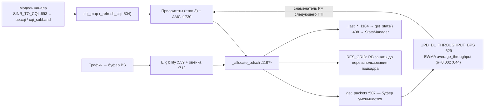

### 2.4. Переходы состояний: жизненный цикл записи CQIMap (на UE)

Заявленный в docstring `CQIMap` (:197–201) жизненный цикл против фактического поведения кода:

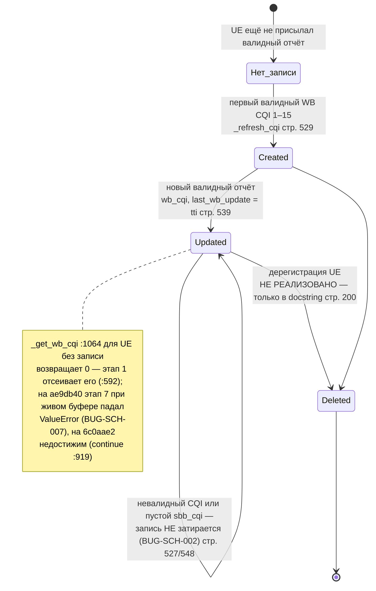

### 2.5. Переходы состояний: бюджет CCE в пределах одного TTI (PDCCHManager)

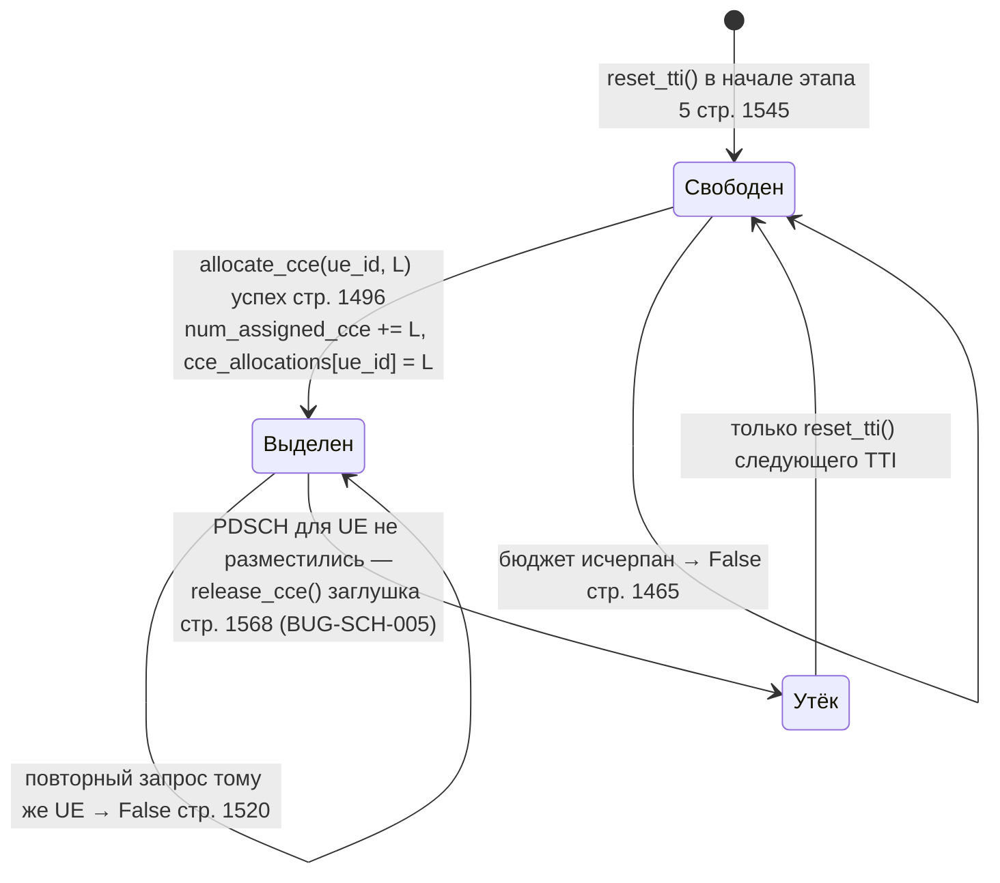

### 2.6. Переходы состояний: UE в скользящем окне (`_ue_queue`)

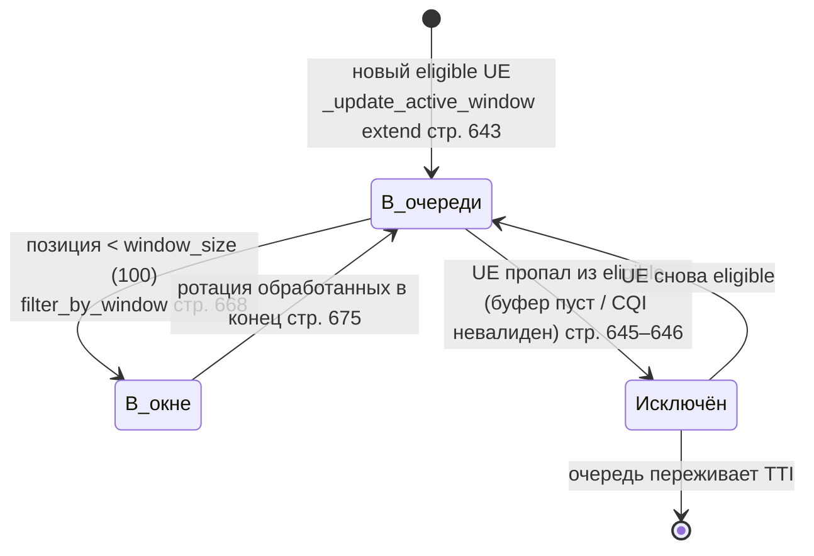

## 3. Целевая структура (TO-BE) — только если согласована

Не согласована: ниже — черновик v2 к спецификации FEAT-SCH-008 (статус и согласование — [features.md](features.md) §1, полный текст — [specs/SPEC-FEAT-SCH-008.md](specs/SPEC-FEAT-SCH-008.md)). Спецификация v2 учла замечания ревью: состояние планирования вынесено в типизированный `SchedulerState` во владении оркестратора, вторая сортировка и top-N остаются в оркестраторе, контракт аллокатора не содержит собственного rollback (атомарность RBG уже внутри `ALLOCATE_RBG`, RES_GRID :430; опасность освобождения без проверки владельца — [BUG-SCH-009](audit.md#bug-sch-009)). Направление «разделить ранжирование пользователей и аллокацию ресурсов» следует из roadmap модуля (:3227–3245) и дублирования механики аллокации в восьми `_allocate_pdsch` (шесть прежних + два QoS-класса из PR #39).

Чтение схемы: без пометки — существующий элемент; **(новый)** — добавляется; **(перенос)** — логика переезжает из указанного места; **(удалено)** — убирается из контракта.

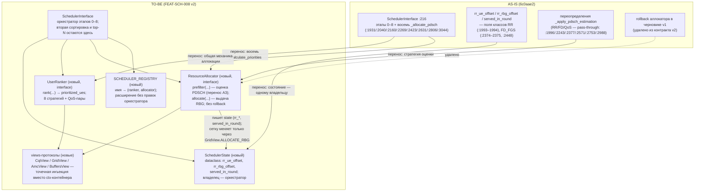

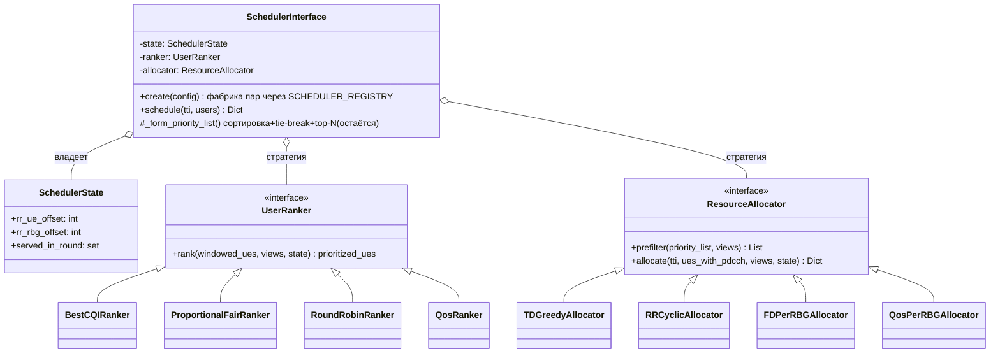

Что изменится относительно AS-IS: общая механика аллокации (`remaining_buffer`, вызов `ALLOCATE_RBG`, сборка индексов RB, условия прерывания), продублированная сейчас в восьми `_allocate_pdsch`, уходит в иерархию `ResourceAllocator`; первоначальный порядок UE — в иерархию `UserRanker`, при этом ranker возвращает `prioritized_ues` как сейчас, а вторая сортировка, tie-break и top-N остаются в `_form_priority_list` (:684) — поведение отбора не меняется; RR/FD-состояние (`rr_*_offset`, `served_in_round`) собирается в `SchedulerState` с правилом «один писатель на поле»; переопределения оценки PDSCH становятся методом `prefilter` стратегии аллокатора. Старые имена фабрики (`'BestCQI'`, `'FD_PF'`, `'QosAware'`, …) сохраняются как пары (ranker, allocator) через реестр — обратная совместимость с `SchedulerConfig` (SIMULATION_MANAGER.py:1030); совместимость фабрики с ядром подтверждается при интеграции, переписывания Simulation Manager не требуется. В ту же схему без изменения оркестратора встраиваются: DRL-ранжирование из ветки `feature/drl-scheduler` (PPO/DQN-ranker) и венгерский бенчмарк ([FEAT-SCH-004](features.md#feat-sch-004) — офлайн эталонный Allocator). Контракт без собственного rollback не отменяет [FEAT-SCH-001](features.md#feat-sch-001): откат CCE при провале PDSCH остаётся задачей оркестратора/менеджера контроля в точке отказа аллокатора.

## 4. Ссылки на исходники

- `PyScheduler/SCHEDULER.py::SchedulerInterface.schedule` (:346–436) — порядок этапов 0–8, досрочные выходы через `_empty_result` (:1037)
- `PyScheduler/SCHEDULER.py::SchedulerInterface.create` (:235) — фабрика восьми алгоритмов (ключи QoS :262–263)
- `PyScheduler/SCHEDULER.py::BasicQosAwareScheduler/QosAwareScheduler` (:2704/:2960) — QoS-классы, слитые в PR #39 (`6c0aae2`)
- `PyScheduler/SCHEDULER.py::_process_buffers` (:880) — ветки отказа с `continue` (:919/:925/:944/:965) и обновление `qci_tput_tracker` (:916–919, :967–975) на `6c0aae2`
- `PyScheduler/SCHEDULER.py::_refresh_cqi` (:504, SB-часть :546) — поведение карты CQI, невалидные отчёты игнорируются
- `PyScheduler/SCHEDULER.py::PDCCHManager.allocate_cce/release_cce/reset_tti` (:1496/:1568/:1545) — учёт CCE и заглушка освобождения
- `PyScheduler/SCHEDULER.py::AdaptiveModulationAndCoding.GET_BITS_PER_RB` (:1730) — CQI → биты/RB, TODO TBS-таблиц :1749
- `PyScheduler/SIMULATION_MANAGER.py::run_tti` (:1657), создание планировщика (:1357), `SchedulerConfig` (:1030), отброшенный результат (:1451), `StatsManager` (:109, collect :158)
- `PyScheduler/UE_MODULE.py::GET_USERS_FOR_SCHEDULER` (:901–920) — контракт входа `users`, ключ `sbb_cqi` (:915)
- `PyScheduler/UE_MODULE.py::UPD_DL_THROUGHPUT_BPS` (:629, EWMA α=0.002 :644), `SINR_TO_CQI` (:693, клампит 1–15)
- `PyScheduler/BS_MODULE.py::IBufferManager` (:472; get_buffer_status :492, get_packets :507, ue_has_buffer :530), `LayeredBufferManager` (:1356), `BaseStation.use_simple_buffer` (:1696)
- `PyScheduler/RES_GRID.py::ALLOCATE_RBG/RELEASE_RBG/GET_RBG_INDICES/GET_RBG_SIZE/GENERATE_BITMAP` (:430/:440/:424/:421/:567), `BANDWIDTH_TO_RB` (:283), `RBG_SIZE_TABLE` (:293); `RELEASE_RB/RELEASE_RBG` (:399/:440) — освобождение без проверки владельца (BUG-SCH-009)
- `PyScheduler/BS_MODULE.py::QciThroughputTracker.update_all_qcis` (:223) — per-QCI throughput, точка встраивания этапа 7
- `PyScheduler/GLOBALS.py::bytes_to_bits` (:217), `BITS_PER_BYTE` (:140), `is_gbr` (:185)

Правила: схемы хранить **текстом Mermaid** в Markdown; AS-IS и TO-BE не смешивать; не рисовать каждую функцию; схема должна соответствовать конкретному коммиту.
