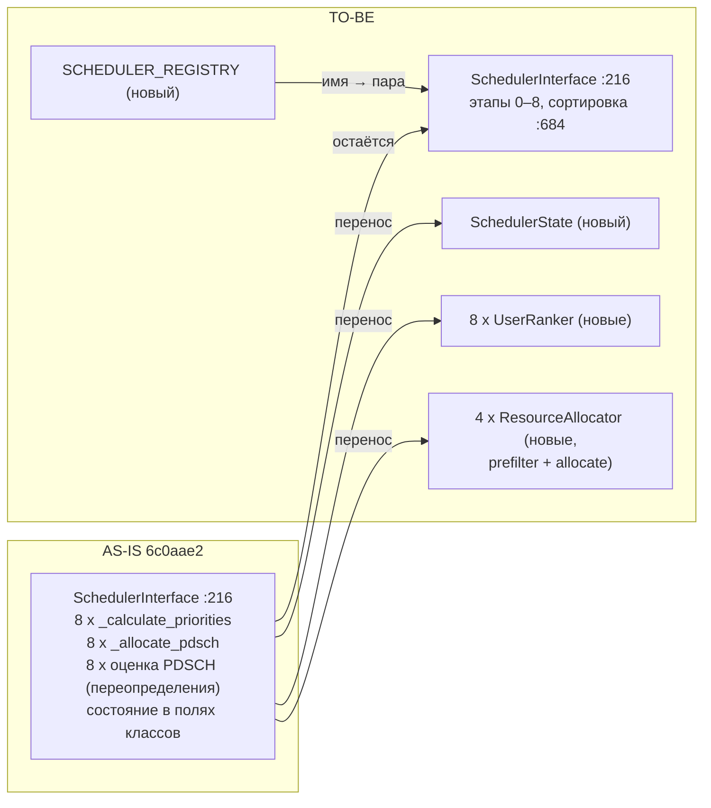

# SPEC-FEAT-SCH-008 — Разделение ранжирования пользователей и аллокации ресурсов (v2)

> Ответственный: Тимур (Scheduler) | Проверено по коду: `6c0aae2` (ветка `dev`) | Обновлено: `2026-10-18`  
> Статус: v2 — замечания ревью v1 учтены (раздел 10); спецификация готова к реализации недельными задачами (раздел 7). Реестровая запись: [features.md](../features.md) FEAT-SCH-008 — архитектурная фича: новые сущности, контракты и точки расширения при неизменном внешнем поведении алгоритмов; прежнее обозначение записи сохранено в таблице соответствия [audit.md §1](../audit.md). Схемы AS-IS/TO-BE: [diagrams.md](../diagrams.md) §1/§3; наблюдения: [audit.md](../audit.md).

## 1. Цель

Механика аллокации (учёт остатка буфера, вызов `ALLOCATE_RBG`, сборка индексов RB, условия прерывания цикла) продублирована в восьми переопределениях `_allocate_pdsch` (`SCHEDULER.py` :1931, :2040, :2160, :2269, :2423, :2631, :2806, :3044), а первоначальный порядок UE — в восьми `_calculate_priorities` (:1908, :2015, :2118, :2250, :2394, :2588, :2764, :2999). Новый алгоритм сейчас означает копирование общего кода или правку чужих веток. Цель — разделить «кому» (ранжирование) и «какие блоки» (аллокацию) на самостоятельные стратегии с явными контрактами так, чтобы:

- добавление алгоритма требовало новой пары стратегий и записи в реестре, но не правок оркестратора и существующих алгоритмов;
- состояние планирования (RR-смещения, раундовые множества) имело одного владельца и явных читателей/писателей;
- поведение существующих алгоритмов не менялось (побитовая регрессия на золотых сценариях).

## 2. Входит / не входит

**Входит:** рефакторинг `SCHEDULER.py` (восемь классов, включая слитые в PR #39 QoS-классы :2704/:2960); контракты `UserRanker`, `ResourceAllocator`, `SchedulerState`, views-протоколы; реестр пар `SCHEDULER_REGISTRY` с сохранением имён фабрики; регрессионные сценарии; правка устаревших docstring ([DOC-SCH-002](../audit.md#doc-sch-002)).

**Не входит:** изменение поведения алгоритмов; таблицы TBS ([FEAT-SCH-002](../features.md#feat-sch-002)); позиции CCE ([FEAT-SCH-007](../features.md#feat-sch-007)); откат CCE ([FEAT-SCH-001](../features.md#feat-sch-001) — точка встраивания описана в разделе 4.3); правки `SIMULATION_MANAGER` и `SchedulerConfig` (запросы в [features.md](../features.md) §2; совместимость фабрики подтверждается при интеграции, переписывания ядра не требуется); owner-check в `RES_GRID` ([BUG-SCH-009](../audit.md#bug-sch-009) — запрос владельцу RES_GRID, раздел 6).

## 3. AS-IS: матрица ответственности восьми алгоритмов

| Класс (:строка) | Первоначальная метрика (ранжирование) | Выбор UE на RBG | Кто меняет сетку | Собственное состояние |
|---|---|---|---|---|
| BestCQI (:1877) | WB CQI (:1908) | жадный TD-цикл (:1931) | `_allocate_pdsch` → `ALLOCATE_RBG` | — |
| RoundRobin (:1985) | ротация очереди от `rr_ue_offset` (:2015, :2028) | 1 RBG по кругу (:2040) | то же | `rr_rbg_offset`, `rr_ue_offset` (:1993–1994, писатель :2090/:2093) |
| ProportionalFair (:2103) | r/R с EWMA-знаменателем (:2118) | жадный TD (:2160) | то же | — |
| FD_BCQI (:2215) | WB CQI (:2250) | per-RBG max SB CQI с fallback WB (:2269) | то же | — |
| FD_FGS (:2339) | RR-ротация (:2394) | per-RBG SB CQI + правило «один UE — один RBG за раунд» (:2423, `served_in_round` :2448–2505) | то же | `rr_*_offset` (:2374–2375), раундовое множество |
| FD_PF (:2524) | WB PF (:2588) | per-RBG пересчёт PF-метрики по SB CQI на каждом RBG (:2631, сравнение :2679) | то же | — |
| BasicQosAware (:2704) | HOL delay × GBR weight × CQA (Coita/PF) (:2764) | per-RBG по той же QoS-метрике (:2806) | то же | `metric_mode` |
| QosAware (:2960) | per-flow (UE, QCI): GBR-смещение + urgency от HOL/PDB (:2999) | per-RBG выбор потока (:3044) | то же | `allocation_flow` |

Три наблюдения, которые v1 не учитывала и которые определяют контракты v2:

1. **Пара «ранкер + жадный аллокатор» покрывает не всё.** У FD_PF метрика пересчитывается на каждом RBG (:2631–2679), у FD_FGS есть раундовые правила и исключения обслуженных UE (:2448–2505), у QoS — выбор на уровне потока. Это не сводится к предварительной сортировке: пересчёт метрики и раундовые правила живут **внутри** цикла аллокации.
2. **Различия алгоритмов не ограничиваются ранжированием и аллокацией.** Переопределения `_apply_pdsch_estimation` (pass-through у RR/FD/QoS: :1996, :2243, :2377, :2571, :2753, :2988 против базовой оценки с порогом 95% :712/:733) — третье место расхождения; взаимодействие с PDCCH (этап 5 :769) и обработка буферов (этап 7 :880) пока общие для всех.
3. **Состояние RR/FD не имеет владельца.** `rr_ue_offset`/`rr_rbg_offset` пишутся внутри `_allocate_pdsch` RR (:2090/:2093) и FD_FGS (:2512/:2514), читаются в `_calculate_priorities` (:2028, :2411); `served_in_round` — локальное множество внутри FD_FGS. При независимых состояниях ранкера и аллокатора последовательность обслуживания UE ломается.

## 4. Целевые контракты

### 4.1 SchedulerState — явное состояние планирования

Небольшой типизированный dataclass без собственной логики; владелец — оркестратор (`SchedulerInterface`), создаётся в `__init__` (:294) и передаётся стратегиям. Никакой системы управления состоянием не вводится.

| Поле | Тип | Читатели | Писатель (единственный) | Сейчас живёт в |
|---|---|---|---|---|
| `rr_ue_offset` | int | RoundRobinRanker (старт ротации), FD-ранкеры | RRCyclicAllocator (:2093) / FDPerRBGAllocator (:2514) по классу алгоритма | поля RR/FD_FGS |
| `rr_rbg_offset` | int | RRCyclicAllocator, FDPerRBGAllocator (RR-составляющая) | RRCyclicAllocator / FDPerRBGAllocator по классу алгоритма (:2090, :2512) | поля RR/FD_FGS |
| `served_in_round` | set[int] | FDPerRBGAllocator (правило раунда, :2468) | FDPerRBGAllocator (очистка :2487–2488, добавление :2505) | локальная переменная FD_FGS |

Правило: одно поле — один писатель; ранкеры состояние не пишут. Оркестратор передаёт один и тот же экземпляр ранкеру и аллокатору на TTI, поэтому согласованность гарантирована порядком вызовов этапов, а не блокировками.

### 4.2 UserRanker — первоначальный порядок UE

```
UserRanker.rank(windowed_ues, views, state) -> List[Dict]   # элементы — те же словари users с полем priority
```

Контракт совпадает с текущим `_calculate_priorities` (:1172): ранкер возвращает `prioritized_ues` **как сейчас** — список с проставленной `priority`, без сортировки. Вторая сортировка, tie-break и отбор top-N (`max_dl_ue_tti`) остаются в оркестраторе `_form_priority_list` (:684): перенос сортировки в стратегии рисковал бы незаметно изменить tie-breaking и состав запланированных UE, а это поведение фиксирует регрессия. Ранжирование пользователей таким образом вынесено из «огромного общего файла» в классы стратегий; ранжирование ресурсов (порядок обхода RBG внутри аллокатора) остаётся внутренним решением аллокатора — это принятое разделение двух ранжирований.

### 4.3 ResourceAllocator — выдача RBG без собственного rollback

```
ResourceAllocator.prefilter(priority_list, views) -> List[Dict]   # перенос переопределений _apply_pdsch_estimation
ResourceAllocator.allocate(tti, ues_with_pdcch, views, state) -> Dict[int, List[int]]
```

- `prefilter` — стратегия оценки PDSCH: базовая реализация — текущая оценка с порогом 95% (:712/:733), RR/FD/QoS-пары дают pass-through (их нынешние переопределения :1996/:2243/:2377/:2571/:2753/:2988). Оркестратор вызывает `prefilter` на месте этапа 4.5 — поведение сохраняется.
- `allocate` — цикл выдачи: TD-жадный, циклический, per-RBG турнир (критерий выбора UE на RBG — подставляемая стратегия: SB CQI, PF-пересчёт, QoS-метрика). Пересчёт метрики на RBG и раундовые правила FD_FGS/QosAware живут здесь, а не в ранкере (наблюдение 3.1).
- **rollback в контракте нет.** Атомарность RBG уже обеспечена внутри `RES_GRID.ALLOCATE_RBG` (:430): при отказе на любом RB вызывается `RELEASE_RBG` (:440). Собственный откат аллокатора поверх этого удвоил бы риск: освобождение в RES_GRID не проверяет владельца блока, и при частичном отказе откат снимает чужие RB ([BUG-SCH-009](../audit.md#bug-sch-009), воспроизведено). Откат управляющего канала (CCE) при провале PDSCH — задача [FEAT-SCH-001](../features.md#feat-sch-001): оркестратор вызывает `release_cce` в точке отказа аллокатора (UE с PDCCH, но без RBG), единой точкой.
- Сетку аллокатор меняет только через `GridView.ALLOCATE_RBG`/`GET_RBG_*`; прямых обращений к полям `lte_grid` нет.

### 4.4 Views — точечная инъекция зависимостей

Стратегии получают не объект-контейнер симулятора, а узкие протоколы; первая реализация — тонкие адаптеры поверх текущих полей оркестратора (поведение не меняется):

| Протокол | Методы | Источник сейчас |
|---|---|---|
| `CqiView` | `get_wb(ue_id) -> int`, `get_sb(ue_id) -> List[int]` | `cqi_map` + `_get_wb_cqi`/_get_sb_cqi (:1064/:1084) |
| `GridView` | `allocate_rbg(tti, rbg, ue) -> bool`, `rbg_size() -> int`, `rbg_indices(rbg) -> List[int]` | `RES_GRID` :430/:421/:424 (контракт зафиксирован в [features.md](../features.md) §2) |
| `AmcView` | `bits_per_rb(cqi) -> int` | `AdaptiveModulationAndCoding.GET_BITS_PER_RB` (:1730) |
| `BuffersView` | `has_buffer(ue) -> bool`, `buffer_status(ue) -> List[BufferStatus]` | `bs.buffer_manager` (:492/:530) |
| `StateView` | чтение/запись полей `SchedulerState` по правилу раздела 4.1 | экземпляр состояния оркестратора |

### 4.5 Распределение особенностей алгоритмов по стратегиям

| Алгоритм | Ranker | prefilter | Allocator | State |
|---|---|---|---|---|
| BestCQI / ProportionalFair | WB CQI / r-R | базовая оценка 95% | TDGreedyAllocator | — |
| RoundRobin | RoundRobinRanker (читает `rr_ue_offset`) | pass-through | RRCyclicAllocator (пишет оба offset) | да |
| FD_BCQI | WB CQI | pass-through | FDPerRBGAllocator (критерий: max SB CQI, fallback WB) | — |
| FD_FGS | RR-ротация | pass-through | FDPerRBGAllocator (критерий SB CQI + раундовые правила) | да |
| FD_PF | WB PF | pass-through | FDPerRBGAllocator (критерий: пересчёт PF на RBG) | — |
| BasicQosAware / QosAware | QoS-метрики (:2764/:2999) | pass-through | QosPerRBGAllocator (метрика Coita/PF; выбор потока) | — |

### 4.6 Реестр и доказательство расширяемости

`SCHEDULER_REGISTRY: Dict[str, Tuple[Type[UserRanker], Type[ResourceAllocator]]]`; `SchedulerInterface.create` (:235) строит пару по имени, неизвестное имя — прежняя ошибка `ValueError: Unknown algorithm` (:268). Все восемь текущих имён, включая `'BasicQosAware'`/`'QosAware'` (:262–263), отображаются на пары — обратная совместимость с `SchedulerConfig` (SIMULATION_MANAGER.py:1030) сохраняется, переписывания ядра не требуется (совместимость подтверждается при интеграции). Список `available_algorithms()` (:277) приводится к ключам реестра — сейчас он расходится с ключами фабрики ([BUG-SCH-010](../audit.md#bug-sch-010)). Доказательство расширяемости — задача T7: алгоритм `FD_RR` (round-robin в FD, имя из прежней истории тестов, [BUG-SCH-008](../audit.md#bug-sch-008)) добавляется двумя классами и одной записью реестра; оркестратор и существующие стратегии не правятся.

### 4.7 wb_cqi / sb_cqi: режимы или политики стратегий

Сейчас: TD-алгоритмы и этап 4.5 используют WB CQI (:1908/:2118, оценка :712, этап 7 :927); FD-алгоритмы выбирают победителя на RBG по SB CQI с fallback на WB при пустом/коротком списке (:2269, :2631–2667); QoS-классы используют собственные CQA-метрики поверх тех же карт. Решение v2: политика доступа к CQI — свойство стратегии через `CqiView` (FD-стратегии запрашивают SB с fallback WB, TD — только WB), глобальный флаг «режим FD/TD» не вводится: он не добавил бы выразительности, но скрыл бы различие в точках применения. Глобальный флаг FD-планирования как запрос ядра остаётся в [FEAT-SCH-003](../features.md#feat-sch-003) ([features.md](../features.md) §2/§3, issue #29).

## 5. Границы ответственности (четыре вопроса)

- **Кто вычисляет метрики:** ранкер — первоначальную (`priority`); аллокатор — пересчитываемую на RBG (FD_PF, QoS) и раундовые поправки (FD_FGS); EWMA-знаменатель и CQI-карты остаются вне стратегий (этап 7 и `cqi_map`).
- **Кто выбирает UE на RBG:** только аллокатор; ранкер в выдаче не участвует.
- **Кто изменяет ресурсную сетку:** только аллокатор, единственным вызовом `GridView.allocate_rbg`; оркестратор и ранкер сетку не трогают; bitmap — этап 8 оркестратора (:1017, `GENERATE_BITMAP` RES_GRID :567).
- **Кто хранит состояние:** оркестратор владеет экземпляром `SchedulerState`; писатели — по таблице 4.1; ранкеры только читают.

## 6. Зависимости и порядок слияния

- **PR #39 (QoS) слит** в `dev` на `6c0aae2` — вопрос «до или после» снят: два QoS-класса входят в объём рефакторинга с задачи T1 (инвентаризация) и переносятся в пары на T6; поведение QoS-классов фиксируется сценарием `TEST_MODULES.py::sim_with_manager_qos` (на `6c0aae2`: `algorithm="QosAware"`, `enable_tdl=True`).
- **PR #33 (RES_GRID, открыт):** контракт `ALLOCATE_RBG/RELEASE_RBG/GET_RBG_*` на время рефакторинга не меняется; `GridInterface` — будущая реализация `GridView`. Запрос владельцу RES_GRID: owner-check при освобождении ([BUG-SCH-009](../audit.md#bug-sch-009)) — вне объёма этой спеки.
- **Тестовый набор** `tests/scheduler_tests/` неработоспособен на `dev` ([BUG-SCH-008](../audit.md#bug-sch-008): нет `log_utils`, имя `FD_RR`, падающий инвариант FD_PF); восстановление запрошено у владельца репозитория и автора тестового набора ([features.md](../features.md) §2) и не входит в объём; приёмка этой работы — золотые сценарии (раздел 8).
- **[DOC-SCH-002](../audit.md#doc-sch-002)** (устаревшие docstring) правится в том же PR, что и T7.
- **Ядро (Simulation Manager):** новых требований нет; совместимость имён фабрики с `SchedulerConfig` подтверждается при интеграции.

## 7. План реализации: недельные задачи

Оценки — кандидаты для Planning Poker по шкале 1/2/3/5/8/13 (относительная сложность, не часы).

| ID | Задача | Результат и приёмка | Оценка |
|---|---|---|---|
| T1 | `SchedulerState` + перенос RR/FD-состояния без изменения поведения | dataclass в оркестраторе; RR/FD_FGS читают/пишут его вместо полей; золотой сценарий README §4 побитово прежний | 1 |
| T2 | views-адаптеры + вынос `prefilter` из переопределений `_apply_pdsch_estimation` | этапы 4.5/6/7 обращаются к views; переопределения удалены, поведение прежнее; золотой + FD-сценарий прежние | 2 |
| T3 | `TDGreedyAllocator` + ранкеры BestCQI/PF; пары в реестре | общая механика TD-аллокации в одном классе; фабрика имён работает; золотой сценарий прежний | 3 |
| T4 | `RRCyclicAllocator` + RoundRobinRanker | ротация offsets через state; RR-сценарий (ротация между TTI) прежний | 2 |
| T5 | `FDPerRBGAllocator` с подставляемым критерием + три FD | критерии SB CQI / PF-пересчёт / раундовые правила — стратегии; FD-сценарий с контрастными SB CQI прежний | 5 |
| T6 | QoS-пары: `QosRanker`, `QosPerRBGAllocator` | `BasicQosAware`/`QosAware` переведены на пары без изменения поведения; сценарий `sim_with_manager_qos` запускается и совпадает с прогоном до переноса | 5 |
| T7 | Вынос стратегий в отдельный модуль (`ALLOCATORS.py`/`RANKERS.py` или пакет), docstring [DOC-SCH-002](../audit.md#doc-sch-002), синхронизация `available_algorithms()` с реестром ([BUG-SCH-010](../audit.md#bug-sch-010)), демонстрация FD_RR, полная регрессия | импорт из нового модуля, имена фабрики прежние; FD_RR добавлен без правок оркестратора; раздел 8 выполнен целиком | 3 |

Порог входа в T3–T6: T1–T2 закрыты и золотой сценарий побитово совпадает. После T7 схема TO-BE ([diagrams.md](../diagrams.md) §3) становится актуальной схемой модуля, разделы README обновляются.

## 8. Проверка и регрессия

1. **Золотой сценарий TTI 5** ([README §4](../../README.md)): `allocation = {1: [6..17], 2: [], 3: [0..5]}`, `pdcch_ue_cce_allocations = {3: 1, 1: 1}` (2/25 CCE), извлечено 8004/2404 бита, EWMA 16008/4808 — побитово до и после каждой задачи; сценарий воспроизведён на `ae9db40` и `6c0aae2`.
2. **FD-сценарий:** per-RBG выбор по контрастным SB CQI (фиксировать таблицу выборов до старта, сравнить после).
3. **RR-сценарий:** ротация `rr_ue_offset`/`rr_rbg_offset` между TTI 5→6→7 (фиксировать последовательность offsets).
4. **QoS-сценарий:** `sim_with_manager_qos` (TEST_MODULES.py, `6c0aae2`) — совпадение allocation с прогоном до переноса.
5. **Полный прогон:** конфигурация с равномерным трафиком, 1000 TTI, сравнение метрик `StatsManager` до/после (ожидаемое расхождение — 0).
6. **Демонстрация расширяемости:** FD_RR по разделу 4.6.
7. Если к моменту приёмки восстановлен тестовый набор ([BUG-SCH-008](../audit.md#bug-sch-008)) — он проходит без изменения ожиданий, кроме зафиксированного инварианта FD_PF (tie-break, там же).

## 9. Схема перехода AS-IS → TO-BE

Полные схемы: [diagrams.md](../diagrams.md) §1 (AS-IS, `6c0aae2`) и §3 (TO-BE v2, с легендой «существующее / новое / перенос / удалено»). Компактно:



## 10. Изменения v1 → v2 (разбор замечаний)

| Замечание | Решение в v2 |
|---|---|
| P0: предположение об атомарном rollback неверно — `ALLOCATE_RBG` уже вызывает `RELEASE_RBG` (:440) без проверки владельца; дополнительный откат усугубляет риск | rollback удалён из контракта (4.3); опасность зафиксирована как [BUG-SCH-009](../audit.md#bug-sch-009) с воспроизведением; откат CCE остался за оркестратором ([FEAT-SCH-001](../features.md#feat-sch-001)) |
| P1: пара Ranker+Allocator слишком упрощена (FD_PF пересчитывает метрику на RBG, FD_FGS — раундовые правила) | пересчёт метрики и раундовые правила явно отнесены в аллокатор (3.1, 4.5); ранкер даёт только первоначальный порядок |
| P1: не определено владение RR-состоянием | `SchedulerState` с таблицей читателей/писателей и правилом «один писатель» (4.1, 5) |
| P1: граница оркестратора недоопределена (оценка PDSCH, PDCCH, буферы) | переопределения оценки стали `prefilter` стратегии (4.3); PDCCH и буферы остаются этапами оркестратора с обоснованием (3.2, 5) |
| Вторая сортировка и tie-break рискованны при переносе | сортировка, tie-break и top-N остаются в `_form_priority_list` (:684); ранкер возвращает `prioritized_ues` как сейчас (4.2) |
| Не превращать ctx в контейнер внутренностей | views-протоколы из пяти точечных интерфейсов (4.4) |
| Доказательство расширяемости | реестр пар + демонстрация FD_RR без правок оркестратора (4.6, T7) |
| wb_cqi/sb_cqi: режимы или нет | политика доступа к CQI — свойство стратегии через `CqiView`; глобальный флаг не вводится (4.7) |
| План должен состоять из задач недельного масштаба | семь задач T1–T7 с приёмками и оценками по шкале 1/2/3/5/8/13 (7) |
| Ссылки на баги — прямые, схемы до/после — из спецификации | прямые ссылки-якоря на карточки [audit.md](../audit.md) и [features.md](../features.md); схема перехода в разделе 9, полные — в diagrams.md §1/§3 |

## 11. Ошибочные и граничные случаи

- Неизвестное имя алгоритма — `ValueError: Unknown algorithm` (:268), поведение фабрики не меняется.
- Пустой список eligible/окна — досрочные выходы оркестратора `_empty_result` (:1037) не затрагиваются; стратегии не вызываются.
- Нет ресурсов: все RBG заняты — аллокатор возвращает пустую/частичную allocation, как текущие `_allocate_pdsch`.
- UE с PDCCH без RBG — точка отказа аллокатора; откат CCE — [FEAT-SCH-001](../features.md#feat-sch-001) (ссылка: [BUG-SCH-005](../audit.md#bug-sch-005)).
- CQI=0 у UE с живым буфером: на `6c0aae2` недостижимо через `schedule()` (фильтр :592 + `continue` :919); стратегии не добавляют новых обращений к `GET_BITS_PER_RB` вне этапа 7 (ссылка: [BUG-SCH-007](../audit.md#bug-sch-007)).
- Частичный отказ `ALLOCATE_RBG` — поведение RES_GRID не меняется; владелец аллокатора не пытается освобождать сам ([BUG-SCH-009](../audit.md#bug-sch-009)).
