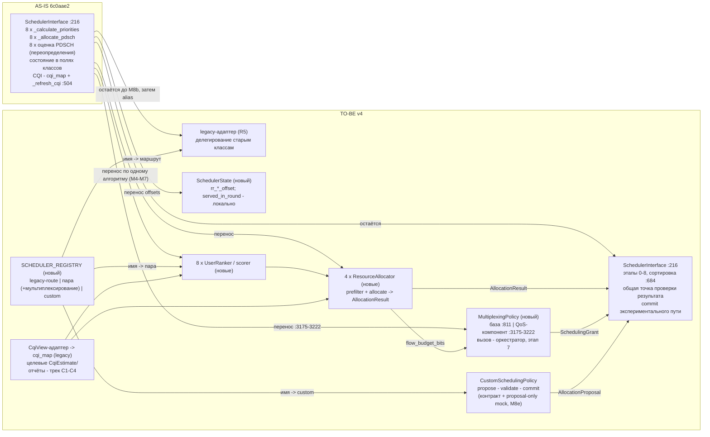

# SPEC-FEAT-SCH-008 — Разделение ранжирования пользователей и аллокации ресурсов (v4)

> Ответственный: Тимур (Scheduler) | Проверено по коду: `6c0aae2` (ветка `dev`) | Обновлено: `2026-10-23`  
> Статус: v4 — учтены четыре замечания P1 архитектурного ревью v3 и уточнения границ от смежных направлений (разбор — раздел 11.2): экспериментальный путь переведён на последовательность propose→validate→commit с фиксированной точкой запуска после этапа PDCCH (5.6); мультиплексирование QoS получила явный контракт `MultiplexingPolicy` как часть M7b (5.3); противоречие порядка M1a/M3 снято самостоятельным подключением prefilter без реестра; неатомарные шаги разбиты (M4c→M4c+M4d, M5→M5a+M5b, M8→M8a–M8e, раздел 8); описание AS-IS BasicQosAware исправлено по коду (раздел 4); потребление CSI алгоритм декларирует явно через `channel_awareness` (5.7); целевые интерфейсы формализованы стандартными `typing.Protocol`/`abc.ABC` (раздел 5). Направление v3 одобрено ревью, замечания приняты к учёту до начала разработки; спецификация не переписана с нуля. Реестровая запись: [features.md](../features.md) FEAT-SCH-008 — архитектурная фича: новые сущности, контракты и точки расширения при неизменном внешнем поведении алгоритмов; прежнее обозначение записи сохранено в таблице соответствия [audit.md §1](../audit.md). Схемы AS-IS/TO-BE: [diagrams.md](../diagrams.md) §1/§3; наблюдения: [audit.md](../audit.md). До согласования v4 реализационные PR не начинаются (правило ревью: сначала контракты и план → согласование → очередной шаг).

## 1. Цель

Механика аллокации (учёт остатка буфера, вызов `ALLOCATE_RBG`, сборка индексов RB, условия прерывания цикла) продублирована в восьми переопределениях `_allocate_pdsch` (`SCHEDULER.py` :1931, :2040, :2160, :2269, :2423, :2631, :2806, :3044), а первоначальный порядок UE — в восьми `_calculate_priorities` (:1908, :2015, :2118, :2250, :2394, :2588, :2764, :2999). Новый алгоритм сейчас означает копирование общего кода или правку чужих веток. Цель — разделить «кому» (ранжирование) и «какие блоки» (аллокацию) на самостоятельные стратегии с явными контрактами так, чтобы:

- добавление алгоритма требовало новой записи в реестре (пара стратегий либо целостная экспериментальная policy, раздел 5.6), но не правок оркестратора и существующих алгоритмов;
- состояние планирования (RR-смещения) имело одного владельца и явных читателей/писателей;
- поведение существующих алгоритмов не менялось (побитовая регрессия на золотых сценариях, раздел 9);
- политику получения/хранения CQI и политику использования доступной CSI можно было настраивать независимо от конкретного планировщика (раздел 5.7);
- переопределение мультиплексирования логических каналов, которое QoS-класс задаёт неявно (`_logical_channel_multiplexing` :3175–3222, вызов через `self` из общего этапа 7 :951), не терялось при переходе к композиции: оно становится явным контрактом `MultiplexingPolicy` с прежней внешней формой грантов (раздел 5.3);
- целевые контракты были формализованы стандартными средствами типизации (`typing.Protocol`, `abc.ABC`), а потребление CSI алгоритмом декларировалось явно (`channel_awareness`), а не выводилось из типа FD/TD (разделы 5, 5.7).

**Инвариант работающего legacy (R1):** цель считается достигнутой не «в конце миграции», а на каждом слитом PR: в любом промежуточном состоянии ветки `dev` все восемь алгоритмов доступны по прежним именам через прежнюю фабрику `SchedulerInterface.create(...)` (:235) и дают прежний внешний результат `schedule()`. **Критерий остановки:** работу над новой архитектурой можно прекратить на любом шаге M — уже слитая в `dev` версия остаётся рабочей, исследовательски воспроизводимой и совместимой с существующим API (включая вызовы из `SIMULATION_MANAGER` и `SchedulerConfig.algorithm`, SIMULATION_MANAGER.py:1044).

**Разграничение объёма:** FEAT-SCH-008 отвечает за архитектуру и совместимый перенос. Реализация задержек/старения CQI, полноценного batch-оптимизатора, TBS, HARQ, исправление `RES_GRID` — самостоятельные последующие задачи; их интерфейсы и точки подключения предусматриваются сейчас (разделы 5.3, 5.4, 5.7, 6), реализация в PR этой работы не втягивается (полный список — раздел 14).

## 2. Правила миграции R1–R8 и Definition of Done атомарного PR

Непереговорные правила каждого шага раздела 8; нарушение любого — основание вернуть PR на доработку.

- **R1. Legacy-first.** В каждом промежуточном состоянии `dev` все существующие алгоритмы доступны по прежним именам, через прежнюю фабрику `SchedulerInterface.create(...)` и с прежним внешним результатом `schedule()`. Контракты с `SIMULATION_MANAGER`, `SchedulerConfig`, `RES_GRID`, `BufferManager` и статистикой сохраняются.
- **R2. Нулевой функциональный дрейф в архитектурных PR.** Рефакторинг не исправляет математические формулы, tie-break, ошибки распределения, расчёт TBS, обработку CQI=0 или старение репортов. Известные дефекты ([BUG-SCH-001](../audit.md#bug-sch-001)–[BUG-SCH-010](../audit.md#bug-sch-010)) фиксируются как наблюдаемое legacy-поведение и исправляются отдельными задачами. Если изменение семантики неизбежно — это отдельная фича/PR с собственными тестами и явным согласованием.
- **R3. Один самостоятельный эффект на PR.** Один PR переносит не более одного алгоритма **или** вводит один инфраструктурный контракт/адаптер. Исключение — неразделимые малые изменения, необходимые для работоспособности данного шага. Не объединять «новый CQI», «FD-PF» и «реестр» в одну поставку.
- **R4. Проверяемость каждого шага.** Каждый PR запускается изолированно, собирается, проходит релевантные unit/characterization/integration-тесты и имеет видимое сравнение до/после. «Полуготовая архитектура, которая заработает после последнего шага» не допускается.
- **R5. Реверсивность.** До окончательной миграции конкретного алгоритма фабрика может маршрутировать его имя на старую реализацию (legacy-route в реестре, раздел 5.6); новый код подключается по одному имени. Для каждого шага M в таблице раздела 8 указан точный способ возврата на legacy-путь (откат PR или переключение маршрута фабрики). Две расходящиеся копии алгоритма не держатся: legacy-адаптер *делегирует существующим методам*, не дублирует их.
- **R6. Отложенные функции не замаскированы.** Если на промежуточном этапе доступны лишь WB или лишь старый FD fallback, это прямо описывается как временный контракт, а не объявляется готовой универсальной CQI-подсистемой (правило применяется к разделу 4.7 и шагам M6a–M6c).
- **R7. Сначала тесты, потом миграция.** До первого изменения реализации фиксируются baseline и короткие characterization-тесты (шаг M0). Падающий исторический набор `tests/scheduler_tests/` ([BUG-SCH-008](../audit.md#bug-sch-008)) «успешной приёмкой» не считается и восстанавливается отдельно.
- **R8. Временное сосуществование старого и нового допустимо.** Удаление legacy-классов и внутренних shim-ов — только после доказанной миграции всех восьми алгоритмов и проверки внешних импортов. Критерий удаления: (а) шаги M4a–M7b закрыты, все восемь имён маршрутизируются через новые пути; (б) два подряд полных прогона раздела 9 зелёные на одном baseline; (в) grep по репозиторию не находит внешних импортов legacy-классов планировщиков. Удаление — отдельный PR после завершения M8a–M8e; до него M8b сохраняет совместимые re-export/alias. Срок: не ранее одного релизного цикла после M8e (релизный цикл фиксируется владельцем репозитория).

**Минимальный Definition of Done каждого атомарного PR:**

- [ ] одно содержательное изменение; явный список затронутых файлов и контрактов;
- [ ] неизменны имена фабрики и публичная форма `schedule()`/статистики;
- [ ] есть автоматический тест нового компонента и регрессионный тест затронутого алгоритма;
- [ ] на фиксированных seed/input сравниваются allocation **и** побочные эффекты: PDCCH/CCE, буфер, throughput, EWMA, QoS flow grants (где применимо), RR offsets;
- [ ] `WB` и `SB` сценарии проверены там, где они раньше использовались; отсутствие отчётов и CQI=0 проверены отдельно;
- [ ] в отчёте указаны база сравнения (SHA), команда запуска, полученный результат, известные отклонения и инструкция отката;
- [ ] нет «заодно» исправленных алгоритмических дефектов или незадекларированных изменений метрик (R2).

## 3. Входит / не входит

**Входит:** рефакторинг `SCHEDULER.py` (восемь классов, включая слитые в PR #39 QoS-классы :2704/:2960); контракты `UserRanker`, `ResourceAllocator`, `SchedulerState`, внутренний `AllocationResult`, views-протоколы; реестр `SCHEDULER_REGISTRY` с legacy-маршрутом и экспериментальным путём `CustomSchedulingPolicy` (только контракт и демонстрационный mock proposal-only); контракт мультиплексирования `MultiplexingPolicy` — шов для QoS-направления: перенос переопределения :3175–3222 в явный компонент дескриптора без изменения внешней формы грантов (5.3); последовательность propose→validate→commit для экспериментального и batch-путей с фиксированной точкой запуска после PDCCH (5.6); **документальная** граница CQI-подсистемы — целевой `CqiView`/`CqiEstimate`, разделение reporting/consumption, явная декларация `channel_awareness` у алгоритмов, сохранение legacy fallback (CQI-C0, раздел 5.7); baseline-тесты и план зелёных шагов M0–M8 (v4: M4c/M4d, M5a/M5b, M8a–M8e); правка устаревших docstring ([DOC-SCH-002](../audit.md#doc-sch-002)).

**Не входит** (детально — раздел 14): реализация CQI-трека C1–C4 (события/метки времени отчётов, явная конфигурация WB/SB, TTL/устаревание, frequency mapper); batch/joint-оптимизатор и венгерский алгоритм (в этой работе — только extension point); DRL-инференс и система plugin discovery; таблицы TBS ([FEAT-SCH-002](../features.md#feat-sch-002)); позиции CCE ([FEAT-SCH-007](../features.md#feat-sch-007)); откат CCE ([FEAT-SCH-001](../features.md#feat-sch-001) — точка встраивания описана в разделе 5.3); owner-check в `RES_GRID` ([BUG-SCH-009](../audit.md#bug-sch-009) — запрос владельцу RES_GRID, раздел 6); правки `SIMULATION_MANAGER` и `SchedulerConfig` (запросы в [features.md](../features.md) §2); восстановление тестового набора ([BUG-SCH-008](../audit.md#bug-sch-008)); HARQ/DCI/AMC/BufferManager/RES_GRID/Simulation Manager — полный рефакторинг этих модулей не производится. Изменение внешнего API чужого модуля — согласование с его владельцем, не часть безусловного объёма Scheduler.

## 4. AS-IS: матрица ответственности восьми алгоритмов

| Класс (:строка) | Первоначальная метрика (ранжирование) | Выбор UE на RBG | Кто меняет сетку | Собственное состояние |
|---|---|---|---|---|
| BestCQI (:1877) | WB CQI (:1908) | жадный TD-цикл (:1931) | `_allocate_pdsch` → `ALLOCATE_RBG` | — |
| RoundRobin (:1985) | ротация очереди от `rr_ue_offset` (:2015, :2028) | 1 RBG по кругу (:2040) | то же | `rr_rbg_offset`, `rr_ue_offset` (:1993–1994, писатель :2090/:2093) |
| ProportionalFair (:2103) | r/R с EWMA-знаменателем (:2118) | жадный TD (:2160) | то же | — |
| FD_BCQI (:2215) | WB CQI (:2250) | per-RBG max SB CQI с fallback WB (:2269) | то же | — |
| FD_FGS (:2339) | RR-ротация (:2394) | per-RBG SB CQI + правило «один UE — один RBG за раунд» (:2423, `served_in_round` :2448–2505) | то же | `rr_*_offset` (:2374–2375), раундовое множество |
| FD_PF (:2524) | WB PF (:2588) | per-RBG пересчёт PF-метрики по SB CQI на каждом RBG (:2631, сравнение :2679) | то же | — |
| BasicQosAware (:2704) | HOL-группировка + GBR-приоритет: `1_000_000 + best_gbr_group` (:2764–2802; группировка :2790, приоритет :2798) | per-RBG: произведение `hol_delay × gbr_weight × cqa_metric` (:2930; группировка :2844, gbr_weight :2887–2889, CQA :2903–2924) | то же | `metric_mode` |
| QosAware (:2960) | per-flow (UE, QCI): GBR-смещение + urgency от HOL/PDB (:2999–3038) | per-RBG выбор потока по метрике `sigmoid(hol, pdb) × pf` (:3044; метрика :3128–3133) | то же | `allocation_flow` |

**Уточнение v4 (по коду `6c0aae2`):** строка BasicQosAware в v3 объединяла две разные формулы в одну «HOL delay × GBR weight × CQA». Фактически ранжирование (`_calculate_priorities` :2764–2802) — это HOL-группировка потоков (`hol_delay // grouping_parameter`, :2790) с GBR-приоритетом (`1_000_000 + best_gbr_group`, :2798): оно задаёт порядок PDCCH-очереди и не содержит CQA-метрики; произведение `hol_delay * gbr_weight * cqa_metric` (:2930) вычисляется **внутри** `_allocate_pdsch` (:2806) при per-RBG выборе потока. Формулы не объединять и не переносить в одну стратегию: M7a переносит группировку в ранкер, произведение — в аллокатор. У QosAware per-RBG метрика `sigmoid(hol, pdb) × pf_metric` (:3128–3133) также отлична от ранжирования :2999–3038.

Четыре наблюдения, которые определяют контракты v3/v4:

1. **Пара «ранкер + жадный аллокатор» покрывает не всё.** У FD_PF метрика пересчитывается на каждом RBG (:2631–2679), у FD_FGS есть раундовые правила и исключения обслуженных UE (:2448–2505), у QoS — выбор на уровне потока. Это не сводится к предварительной сортировке: пересчёт метрики и раундовые правила живут **внутри** цикла аллокации.
2. **Различия алгоритмов не ограничиваются ранжированием и аллокацией.** Переопределения `_apply_pdsch_estimation` (pass-through у RR/FD/QoS: :1996, :2243, :2377, :2571, :2753, :2988 против базовой оценки с порогом 95% :712/:733) — третье место расхождения; взаимодействие с PDCCH (этап 5 :769) общее для всех. Каркас этапа 7 (:880) в v3 также считался общим; v4 уточняет: мультиплексирование внутри этапа 7 переопределяется QoS-классом (`_logical_channel_multiplexing` :3175–3222, вызов через `self` из общего `_process_buffers` :951) — четвёртое место расхождения, закрытое контрактом `MultiplexingPolicy` (5.3).
3. **Состояние RR/FD не имеет владельца.** `rr_ue_offset`/`rr_rbg_offset` пишутся внутри `_allocate_pdsch` RR (:2090/:2093) и FD_FGS (:2512/:2514), читаются в `_calculate_priorities` (:2028, :2411); `served_in_round` — локальное множество внутри FD_FGS. При независимых состояниях ранкера и аллокатора последовательность обслуживания UE ломается.
4. **У QoS есть второй выход — per-flow решения.** `QosAwareScheduler._allocate_pdsch` ведёт `allocation_flow` (инициализация :3087, запись бюджета потока :3149), который затем читает `_logical_channel_multiplexing` (:3175–3222, фильтр по QCI :3193–3195) для сборки `SchedulingGrant`. Контракт аллокатора «только `Dict[UE, List[PRB]]`» потерял бы эти решения либо оставил бы скрытый побочный канал через поле экземпляра (`self.allocation_flow` :2986). Отсюда внутренний тип `AllocationResult` (раздел 5.3).

### 4.1 Потоки данных, которые нельзя потерять при переносе

| Поток | AS-IS маршрут | Что фиксирует v3/v4 |
|---|---|---|
| CSI/CQI | UE_MODULE → `_refresh_cqi` (:504–559, вызов :365–366 по `wb_cqi_upd_interval` :336) → `cqi_map` (`CQIMap` :190–208) → `_get_wb_cqi`/`_get_sb_cqi` (:1064/:1084) → TD-метрики и этап 4.5/7 (:737, :927); FD per-RBG (:2269, :2631–2667) | целевой контракт `CqiEstimate`/`CqiView` и legacy-адаптер (5.7); `_refresh_cqi` — копирование значений, не событие получения отчёта |
| QoS per-flow | `_calculate_priorities` (:2999) → `allocation_flow` (:3087, :3149) → `_logical_channel_multiplexing` (:3175–3222) → `SchedulingGrant` → извлечение пакетов и per-QCI throughput (этап 7, `qci_tput_tracker` :916) | `AllocationResult.flow_budget_bits` (5.3); компонент `MultiplexingPolicy` — перенос :3175–3222 без изменения внешней формы грантов; оркестратор вызывает компонент из дескриптора, а не через `self` |
| RR-состояние | поля классов (:1993–1994, :2374–2375) → чтение в `_calculate_priorities` (:2028, :2411) → запись в `_allocate_pdsch` (:2090/:2093, :2512/:2514) | `SchedulerState` с единственным писателем (5.1); `served_in_round` остаётся локальным |
| Сетка | `_allocate_pdsch` → `lte_grid.ALLOCATE_RBG` (RES_GRID :430) → bitmap этапа 8 (:1017, `GENERATE_BITMAP` RES_GRID :567) | только через `GridView`; batch-commit — будущая точка расширения (5.3) |

## 5. Целевые контракты

**Формализация v4:** контракты ниже фиксируются стандартными средствами типизации Python — границы «только чтение/структурная совместимость» (`UserRanker`, `ResourceAllocator`, `CqiView`, views, `MultiplexingPolicy`, `CustomSchedulingPolicy`) описываются через `typing.Protocol` (структурная типизация, наследование не обязательно); границы с общей реализацией (базовые аллокаторы, базовая оценка prefilter) — через `abc.ABC` с абстрактными методами. Собственная метапрограмма интерфейсов, сервис-локатор, контейнер зависимостей и event bus не вводятся (раздел 14). Для каждого контракта в разделах 5.1–5.7 указано, каким средством он оформляется и кто реализует его на шагах M.

### 5.1 SchedulerState — явное состояние планирования

Небольшой типизированный dataclass без собственной логики; владелец — оркестратор (`SchedulerInterface`), создаётся в `__init__` (:294) и передаётся стратегиям. Никакой системы управления состоянием не вводится.

| Поле | Тип | Читатели | Писатель (единственный) | Сейчас живёт в |
|---|---|---|---|---|
| `rr_ue_offset` | int | RoundRobinRanker (старт ротации), FD-ранкеры | RRCyclicAllocator (:2093) / FDPerRBGAllocator (:2514) по классу алгоритма | поля RR/FD_FGS |
| `rr_rbg_offset` | int | RRCyclicAllocator, FDPerRBGAllocator (RR-составляющая) | RRCyclicAllocator / FDPerRBGAllocator по классу алгоритма (:2090, :2512) | поля RR/FD_FGS |

Правило: одно поле — один писатель; ранкеры состояние не пишут. Оркестратор передаёт один и тот же экземпляр ранкеру и аллокатору на TTI, поэтому согласованность гарантирована порядком вызовов этапов, а не блокировками.

**Изменение v3:** `served_in_round` (FD_FGS :2448) **не переносится** в `SchedulerState`. Это алгоритмическое ограничение текущего раунда внутри одного вызова аллокации — оно остаётся локальной переменной `allocate()`. В долгоживущем состоянии оно рискует протечь между TTI; долговременные offsets принадлежат экземпляру Scheduler, имеют одного писателя (аллокатор) и читаются ранкером.

### 5.2 UserRanker / scorer — оценка кандидатов

```
UserRanker.rank(windowed_ues, views, state) -> List[Dict]   # элементы — те же словари users с полем priority
```

Контракт совпадает с текущим `_calculate_priorities` (:1172): ранкер возвращает `prioritized_ues` **как сейчас** — список с проставленной `priority`, без сортировки. Вторая сортировка, tie-break и отбор top-N (`max_dl_ue_tti`) остаются в оркестраторе `_form_priority_list` (:684): перенос сортировки в стратегии рисковал бы незаметно изменить tie-breaking и состав запланированных UE, а это поведение фиксирует регрессия.

**Граница оценки (v3).** Ранкер/scorer оценивает кандидатов и возвращает приоритет, utility/метрику либо упорядоченный список. Он **не вызывает** `GridView.allocate_rbg` и не обновляет счётчики занятости RBG; сетку не меняет (раздел 6). Две совместимые формы оценки, универсальный интерфейс `Scorer` для каждой реализации сейчас не требуется:

1. **TD-форма:** готовые приоритеты UE (текущий контракт `rank`).
2. **FD-форма (целевая):** `score_candidate(ue, rbg, flow?, tti) -> float` — оценка пары `(UE, RBG)`, для QoS — тройки `(UE, flow)`. Программная реализация расширенной формы — отдельный атомарный шаг (M6a вводит её только как подставляемый критерий внутри FD-аллокатора), без одновременного изменения формул FD.

Оценка UE–RBG/flow в будущем поддерживается контрактом без правок `GridView`: ранжирование ресурсов (порядок обхода RBG внутри аллокатора) остаётся внутренним решением аллокатора — принятое разделение двух ранжирований сохраняется.

### 5.3 ResourceAllocator — выдача RBG, результат, extension points

```
ResourceAllocator.prefilter(priority_list, views) -> List[Dict]   # перенос переопределений _apply_pdsch_estimation
ResourceAllocator.allocate(tti, ues_with_pdcch, views, state) -> AllocationResult
```

- `prefilter` — стратегия оценки PDSCH: базовая реализация — текущая оценка с порогом 95% (:712/:733, точка вызова в оркестраторе :405), RR/FD/QoS-пары дают pass-through (их нынешние переопределения :1996/:2243/:2377/:2571/:2753/:2988). Перенос выполняется отдельным малым шагом (M1a) с сохранением **точного времени вызова** и пропуска 95%-оценки у RR/FD/QoS; не объединяется с миграцией алгоритмов.
- `allocate` — цикл выдачи: TD-жадный, циклический, per-RBG турнир. **Временное миграционное решение:** критерий выбора UE на RBG (SB CQI, PF-пересчёт :2631–2679, QoS-метрика :3044) и раундовые правила FD_FGS (:2448–2505) живут внутри FD/QoS-аллокатора как подставляемая функция-критерий — это допустимо только ради нулевого дрейфа (R2). **Целевая граница:** формулы полезности принадлежат ранкеру/scorer (`score_candidate`, раздел 5.2), аллокатору — правила назначения и ресурсные ограничения; аллокатор запрашивает `score(ue, rbg, context)` или получает матрицу utility для глобального метода и не содержит формулу PF, QoS HOL/PDB/GBR, Coita или DRL reward как собственное правило аллокации.

**AllocationResult (v3) — внутренний тип результата; внешняя форма `schedule()` не меняется:**

```python
@dataclass(frozen=True)
class AllocationResult:
    ue_prbs: dict[int, tuple[int, ...]]
    flow_budget_bits: dict[tuple[int, int], int] | None = None
    # На первом этапе ключ — (UE, QCI), как в legacy allocation_flow (:3087/:3149).
    # Позже перейти на стабильный FlowId/LCID, если у UE несколько потоков одного QCI (раздел 12).
```

На первых этапах старые методы могут возвращать прежний `Dict`, а `LegacyAllocationAdapter` преобразует его в `AllocationResult` без изменения алгоритма; оркестратор на этапе 7 собирает `allocation` из `ue_prbs` побитово как сейчас. Для QoS отдельным шагом (M6d) `allocation_flow` явно переносится в `flow_budget_bits`, проверяются прежние `SchedulingGrant` (:3175–3222), извлечение пакетов и per-QCI throughput. QoS-алгоритмы не переносятся (M7a/M7b), пока `AllocationResult` не введён и не проверен.

**MultiplexingPolicy (v4) — явный контракт мультиплексирования логических каналов (замечание P1 ревью v3):**

AS-IS: `QosAwareScheduler` переопределяет `_logical_channel_multiplexing` (:3175–3222; базовая реализация :811), а общий этап 7 `_process_buffers` (:880) вызывает его через `self` (:951) — поведение мультиплексирования выбирается неявно классом планировщика. При композиции это переопределение теряется: оркестратор не наследует QoS-класс, и базовая реализация :811 молча подменяет QoS-логику (гранты и per-QCI throughput расходятся с baseline). Решение v4:

```python
class MultiplexingPolicy(Protocol):   # структурная типизация, наследование не обязательно
    def multiplex(self, tti: int, ue: int, tb_bytes: int,
                  buffer_statuses: List[BufferStatus],
                  flow_budgets: dict[tuple[int, int], int],
                  views: Views) -> List[SchedulingGrant]: ...
```

- дескриптор пары в реестре получает необязательный четвёртый элемент — компонент мультиплексирования: `('pair', RankerCls, AllocatorCls[, MultiplexingCls])` (раздел 5.6); у семи не-QoS-алгоритмов элемент отсутствует, и оркестратор применяет базовую реализацию как на :811;
- QoS-компонент — перенесённый **без изменений** (нулевой дрейф, R2) код :3175–3222: читает `AllocationResult.flow_budget_bits` и состояния буферов, возвращает `SchedulingGrant` в прежней внешней форме; извлечение пакетов и per-QCI throughput этапа 7 не меняются;
- оркестратор на этапе 7 вызывает компонент из дескриптора вместо `self._logical_channel_multiplexing`; точка вызова (:951) и передаваемые величины (`tb_size`/`buffer_status_list`) сохраняются — меняется только способ выбора реализации;
- перенос и проверка компонента входят в **M7b** (переопределение существует только у `QosAwareScheduler`, :3175): LC multiplexing, гранты и per-QCI throughput совпадают с baseline; отсутствие компонента в QoS-дескрипторе — ошибка построения реестра, обнаруживается на инициализации (fail fast), а не в TTI (раздел 12);
- дальнейшая эволюция QoS-мультиплексирования (TBS-aware LCP, приоритеты LCID, новые формы грантов) в FEAT-SCH-008 **не входит**: работа передаёт QoS-направлению шов — контракт, точку в реестре и `flow_budget_bits`; последующие изменения поведения — отдельные карточки владельца QoS-направления (раздел 6, [features.md](../features.md) §2).

- **rollback в контракте нет.** **Оговорка по безопасности сетки (v3):** `RES_GRID.ALLOCATE_RBG` (:430) на `6c0aae2` при отказе на любом RB вызывает `RELEASE_RBG` (:440), который освобождает RB без проверки владельца (RES_GRID :399) — поэтому операция **не является гарантированно атомарной**, и спецификация это не утверждает ([BUG-SCH-009](../audit.md#bug-sch-009), воспроизведено). Исправление — отдельная задача владельца RES_GRID (раздел 6), вне этой работы. Аллокатор собственного отката не делает; тест сеточного конфликта обязателен (раздел 9); известный риск фиксируется в карточке фичи. Откат управляющего канала (CCE) при провале PDSCH — задача [FEAT-SCH-001](../features.md#feat-sch-001): оркестратор вызывает `release_cce` в точке отказа аллокатора (UE с PDCCH, но без RBG), единой точкой.
- Сетку аллокатор меняет только через `GridView.allocate_rbg`/`GridView.rbg_*`; прямых обращений к полям `lte_grid` нет.
- **Extension point «sequential vs batch» (только документация, без реализации solver).** Контракт не подразумевает единственный цикл «следующий RBG → следующий UE». Предусматриваются две реализации механизма назначения: **sequential** (greedy/cyclic — текущие) и **batch/global** (матрица utility/ограничений → план выделения → commit). Для batch потребуются чтение snapshot доступных RBG (`GridView.snapshot_free()`) и безопасный commit (`GridView.commit(plan)`); нынешний `GridView` только с `allocate_rbg()` этого не гарантирует — методы описываются контрактом сейчас, реализуются после исправления [BUG-SCH-009](../audit.md#bug-sch-009). Классический венгерский алгоритм — assignment один-к-одному; выдача многих RBG одному UE требует отдельной постановки (b-matching / min-cost-flow / размножение слотов), а выбор MCS/TBS может связать ёмкость с совокупным выделением — исследовательская задача [FEAT-SCH-004](../features.md#feat-sch-004), не обязательство FEAT-SCH-008.

### 5.4 Views — точечная инъекция зависимостей

Стратегии получают не объект-контейнер симулятора, а узкие протоколы; первая реализация — тонкие адаптеры поверх текущих полей оркестратора (поведение не меняется). Прямые `lte_grid`/`buffer_manager` в стратегии «в обход» адаптеров не передаются.

| Протокол | Методы (legacy-форма M1) | Источник сейчас |
|---|---|---|
| `CqiView` | `get_wb(ue_id) -> int`, `get_sb(ue_id) -> List[int]`; целевая форма — `get_wb(ue_id, tti) -> CqiEstimate`, `get_for_rbg(ue_id, rbg_idx, tti) -> CqiEstimate` (раздел 5.7, внедряется в CQI-треке, не в M6) | `cqi_map` + `_get_wb_cqi`/`_get_sb_cqi` (:1064/:1084) |
| `GridView` | `allocate_rbg(tti, rbg, ue) -> bool`, `rbg_size() -> int`, `rbg_indices(rbg) -> List[int]`, `total_rbg() -> int`, `prb_count() -> int`; будущее (batch): `snapshot_free()`, `commit(plan)` | `RES_GRID` :430/:421/:424, `rb_per_slot`; `total_rbg` — как в QoS (:3088–3089) |
| `AmcView` | `bits_per_rb(cqi) -> int` | `AdaptiveModulationAndCoding.GET_BITS_PER_RB` (:1730) |
| `BuffersView` | `has_buffer(ue) -> bool`, `buffer_status(ue) -> List[BufferStatus]`, `hol_delay(ue, qci) -> int` | `bs.buffer_manager` (:574/:580/:584); HOL — как в QoS-метриках (:3029) |
| `StatsView` (v3) | `ue_throughput(ue) -> float` (EWMA/average), `qci_throughput(ue, qci)`, `gbr_of(qci)`, `pdb_of(qci)` | `user['ue'].average_throughput` (:2133), обновление EWMA — этап 7 (:915–947, `UPD_DL_THROUGHPUT_BPS`); `qci_tput_tracker` (:916); GBR — `GLOBALS.QCI_PROFILES[qci]["gbr"]` (:2884), `GLOBALS.is_gbr` (:2792); PDB — `QCI(qci).get_delay_budget()` (TRAFFIC_MODEL, использование :3029/:3126) |
| `StateView` | чтение/запись полей `SchedulerState` по правилу раздела 5.1 | экземпляр состояния оркестратора |

**Инвентаризация входов (обязательна до M4).** В v2 у `rank`/`prefilter`/`allocate` часть необходимых данных не была указана явно. До первого переноса алгоритма (в рамках M1) инвентаризируются фактические обращения всех восьми реализаций и фиксируется, откуда приходят: `tti` (аргумент этапов), полный `eligible_ues` для инициализации allocation map (:1197), число PRB/RBG (`GridView`), throughput/EWMA и QCI-specific throughput, GBR/PDB, идентификаторы потоков (`BuffersView`/`StatsView`). Итог инвентаризации — таблица входов по восьми алгоритмам в черновике M1; расхождение таблицы с кодом трактуется в пользу кода.

### 5.5 Распределение особенностей алгоритмов по стратегиям

| Алгоритм | Ranker | prefilter | Allocator | State |
|---|---|---|---|---|
| BestCQI / ProportionalFair | WB CQI / r-R | базовая оценка 95% | TDGreedyAllocator | — |
| RoundRobin | RoundRobinRanker (читает `rr_ue_offset`) | pass-through | RRCyclicAllocator (пишет оба offset) | да |
| FD_BCQI | WB CQI | pass-through | FDPerRBGAllocator (критерий: max SB CQI, fallback WB) | — |
| FD_FGS | RR-ротация | pass-through | FDPerRBGAllocator (критерий SB CQI + раундовые правила; `served_in_round` локально) | да |
| FD_PF | WB PF | pass-through | FDPerRBGAllocator (критерий: пересчёт PF на RBG) | — |
| BasicQosAware / QosAware | QoS-метрики (:2764/:2999) | pass-through | QosPerRBGAllocator (метрика Coita/PF; выбор потока; результат — `AllocationResult` с `flow_budget_bits`) | — |

Пометка v3: per-RBG scoring внутри FD/QoS-аллокаторов — **временное legacy-решение** миграционного периода (нулевой дрейф), а не целевая SRP-граница; целевое состояние — формулы в scorer, аллокатор запрашивает оценки (раздел 5.2/5.3).

### 5.6 Реестр: legacy-route, пары стратегий, экспериментальный путь

```python
SCHEDULER_REGISTRY: Dict[str, Descriptor]

Descriptor = ('pair',  RankerCls, AllocatorCls[, MultiplexingCls])  # стандартный путь; 4-й элемент — компонент мультиплексирования (v4, только QoS, 5.3)
           | ('custom', CustomSchedulingPolicyCls)       # экспериментальный путь (v4: propose→validate→commit)
           | ('legacy', LegacySchedulerCls)              # маршрут на старую реализацию (R5)

# на этапе M3 все восемь имён — ('legacy', <текущий класс>);
# по мере миграции имена по одному переключаются на ('pair', ...)
```

`SchedulerInterface.create` (:235) строит объект по дескриптору; неизвестное имя — прежняя ошибка `ValueError: Unknown algorithm` (:268). Все восемь текущих имён, включая `'BasicQosAware'`/`'QosAware'` (:262–263), сохраняются — обратная совместимость с `SchedulerConfig` (SIMULATION_MANAGER.py:1044) не требует переписывания ядра (совместимость подтверждается при интеграции). Список `available_algorithms()` (:277) приводится к ключам реестра — сейчас он расходится с ключами фабрики ([BUG-SCH-010](../audit.md#bug-sch-010)). Публичная фабрика и список допустимых имён не меняются; расширение внутреннего реестра новыми видами дескрипторов правок оркестратора не требует.

**Экспериментальный путь — `CustomSchedulingPolicy` (v4: propose→validate→commit, только контракт и демонстрационный mock):**

```python
class CustomSchedulingPolicy(Protocol):
    def propose(self, tti: int, eligible_ues: List[Dict], ues_with_pdcch: List[Dict],
                views: Views, state: SchedulerState) -> AllocationProposal: ...

@dataclass(frozen=True)
class AllocationProposal:   # та же структура, что AllocationResult, но ещё не commit
    ue_prbs: dict[int, tuple[int, ...]]
    flow_budget_bits: dict[tuple[int, int], int] | None = None
```

Целостная policy (DRL, joint-оптимизация, гибриды) определяет выбор UE/RBG целиком, без искусственного разложения на Ranker+Allocator.

**Точка запуска относительно PDCCH (v4, замечание P1 ревью v3).** Policy вызывается **после** этапа PDCCH (:769) и получает оба списка явно — `eligible_ues` и `ues_with_pdcch`; в v3 второй список отсутствовал, и момент запуска оставался неопределённым. Policy **не** выбирает получателей PDCCH и не вызывает этап PDCCH: выдача CCE остаётся за оркестратором (этап 5). Допущение «симулятор вычисляет PDCCH до аллокации» верно для PyScheduler на `6c0aae2` (порядок этапов :769 → аллокация); для внешних систем (например, srsRAN) возможно совместное вычисление PDCCH/PDSCH — **не проверено**. При появлении такой интеграции точка запуска фиксируется порядком этапов оркестратора, а не внутри policy.

**Последовательность propose→validate→commit (v4, замечание P1 ревью v3).** Пост-проверка результата *после* выполнения алгоритма небезопасна: если алгоритм уже изменил `RES_GRID`, отказ проверки не гарантирует сохранность сетки — при ошибке ресурсы могут остаться занятыми (оговорка о безопасности сетки, §5.3). Экспериментальный и batch-пути поэтому разделяются на три фазы:

1. **propose** — policy вычисляет план на снимке свободных ресурсов `GridView.snapshot_free()`: `AllocationProposal` (UE→RBG/PRB, бюджеты потоков). Никаких изменений сетки, буферов, `SchedulerState` и статистики на этой фазе нет.
2. **validate** — оркестратор проверяет план на инварианты **до** любых изменений: UE плана — из допущенного множества и из `ues_with_pdcch`; PRB/RBG корректны и не пересекаются между UE в пределах TTI; квоты (число UE на TTI) соблюдены; `flow_budget_bits` согласован с планируемыми RBG. Validate вправе исключить из плана отдельных UE с фиксацией в trace; план, невалидный структурно или опустевший, отклоняется целиком: TTI продолжается без аллокации по custom-пути с записью в trace, сетка при этом не тронута.
3. **commit** — единственная точка изменений, выполняет **только оркестратор**: транзакционный `GridView.commit(plan)` (всё-или-ничего) реализуется после исправления owner-check в RES_GRID ([BUG-SCH-009](../audit.md#bug-sch-009)); до него — последовательные `GridView.allocate_rbg` в фиксированном порядке плана, частичный отказ обрабатывается как в legacy (:430/:440, оговорка §5.3).

Policy не выполняет commit: прямых вызовов `GridView.allocate_rbg`, записи буферов/состояния/статистики у policy нет. **До реализации механизма propose→validate→commit в плане (M8e) остаётся только mock proposal-only:** mock возвращает план, commit выполняет оркестратор через существующие `allocate_rbg`; произвольные изменения сетки policy запрещены.

Требования:

1. **Общая точка проверки результата.** Оба пути (пара и custom) проходят через единую проверку в оркестраторе: pair — после `allocate` (sequential legacy-совместимый путь), custom — в фазе validate до commit. Нарушение — фиксация в статистике/trace и пустой результат для нарушившего UE (pair) либо исключение UE/отклонение плана (custom), не «тихое» продолжение.
2. **Инварианты ресурсной модели.** Custom policy заменяет эвристики ранжирования/аллокации, но не обходит инварианты: чтение сетки — только снимок `GridView.snapshot_free()`, запись — только через commit оркестратора; учёт переданных данных — через существующий этап 7; произвольно менять внутреннее состояние системы policy не может.
3. **Без правок оркестратора и фабрики** при добавлении новой policy (новая запись реестра).
4. **Стабилизация.** Если экспериментальный алгоритм стабилизировался, его части постепенно выносятся в обычные Ranker/Allocator без изменения вызывающей стороны.

DRL-инференс и plugin discovery не внедряются; демонстрация — mock-полис proposal-only (M8e). Доказательство расширяемости стандартного пути — алгоритм `FD_RR` (round-robin в FD, имя из прежней истории тестов, [BUG-SCH-008](../audit.md#bug-sch-008)) добавляется двумя классами и одной записью реестра (M8d).

### 5.7 Политика CQI — независимая граница (v3, уточнения v4)

#### 5.7.1 AS-IS: как CQI живёт сейчас

`_refresh_cqi()` (:504–559) периодически копирует значения WB/SB из записей users в `cqi_map` (`CQIMap` :190–208); вызов — из `schedule()` с частотой `wb_cqi_upd_interval` (:336, точка вызова :365–366). **Это не эквивалент поступлению нового CQI report:** при неизменном входном значении измерение нельзя автоматически объявлять свежим. `last_wb_update`/`last_sb_update` (:203/:207) — метки времени refresh, а не времени измерения; `wb_cqi_upd_interval` — частота вызова refresh, `sb_cqi_upd_interval` (:337) не является независимым расписанием получения SB. Спецификация v3 не называет их реализованными механизмами устаревания. Точки использования: TD — только WB (:1908/:2118, оценка :737, этап 7 :927); FD — SB с fallback на WB при пустом/коротком списке (:2269, :2631–2667); QoS — собственные CQA-метрики поверх тех же карт (:2764/:2999).

#### 5.7.2 Две ортогональные настройки

- **A. Reporting / CSI availability** — какие отчёты формирует и передаёт источник, с какой периодичностью, задержкой и качеством. В новой явной конфигурации `WB` — default, `WB+SB` — опциональная возможность; в будущем: periodic/aperiodic, delay/loss, максимальный возраст, hold-last (трек C1–C3, раздел 5.7.6).
- **B. Channel-awareness / consumption** — какие из **имеющихся у планировщика** отчётов алгоритм вправе использовать при оценке кандидатов: режим может требовать WB, разрешать per-RBG оценки с SB или запрещать SB→WB fallback для конкретного эксперимента. **Декларация v4:** каждый алгоритм/политика явно объявляет потребляемый набор CSI атрибутом класса `channel_awareness: tuple[str, ...]` — `("WB",)` у TD-алгоритмов, `("WB", "SB")` у FD; декларация проверяется против `report_mode` конфигурации при инициализации реестра. Это документация и проверка согласованности, **не автоматический переключатель режимов**: включение SB reporting само по себе не меняет поведение алгоритма (auto-switch запрещён), решение о потреблении остаётся в коде политики, как на `6c0aae2`.

**Не смешивать** `report_mode=WB/SB` с типом `TD/FD` или алгоритмом `PF/RR`: включение SB reporting само по себе не превращает TD-PF в FD-PF — оно лишь делает данные доступными, а решение об использовании определяется возможностями выбранной политики. RR может распределять RBG и без SB; это не означает частотно-селективного выбора по качеству канала. Решение v2 «глобальный флаг FD/TD не вводится» остаётся в силе; глобальный флаг FD-планирования как запрос ядра — по-прежнему [FEAT-SCH-003](../features.md#feat-sch-003) ([features.md](../features.md) §2/§3, issue #29).

**Совместимость.** Конфигурации без нового поля сохраняют семантику `6c0aae2` (TD — WB; FD — SB при наличии и fallback WB): поведение FD у существующих пользователей при подключении новых настроек молча не меняется — режим `legacy_auto`. Для **новых явно заданных конфигураций** предпочтителен `report_mode=WB`, а SB включается отдельно — режим `wb_only`; оба значения описаны явно. Момент будущей смены default фиксируется отдельной задачей (CQI-C2), не в этой работе.

#### 5.7.3 Отчёты: данные и время жизни (целевой контракт)

Совместимость с существующим `CQIMap` (:190–208) сохраняется, но на уровне будущего контракта различаются: значение WB и набор SB/частотных оценок; `measurement_tti` (когда канал измерен) и `received_tti` (когда отчёт стал доступен Scheduler); возраст `current_tti - measurement_tti`, пригодность и причина невалидности; идентификатор/гранулярность частотных поддиапазонов — соответствие «1 CQI = 1 RBG» навсегда не зашивается.

#### 5.7.4 Контракт доступа для потребителей

```python
@dataclass(frozen=True)
class CqiEstimate:
    value: int | None
    source: str             # WB | SB | NONE
    measurement_tti: int | None
    received_tti: int | None
    valid: bool
    fallback_used: bool
    reason: str | None

class CqiView(Protocol):
    def get_wb(self, ue_id: int, tti: int) -> CqiEstimate: ...
    def get_for_rbg(self, ue_id: int, rbg_idx: int, tti: int) -> CqiEstimate: ...
```

Это **целевой дизайн**, а не требование переписать все алгоритмы в первом PR. Для первой миграции (M1–M8) разрешён узкий legacy-адаптер с методами `get_wb(ue_id) -> int` / `get_sb(ue_id) -> List[int]`, возвращающий прежние значения (раздел 5.4). Информация для будущего `get_for_rbg` закладывается в интерфейс и отдельную CQI-фичу. Стратегиям **не разрешается** напрямую управлять таймерами или обновлять `CQIMap` — запись только у владельца CQI-данных (раздел 6). **Проверка деклараций v4:** расхождение `channel_awareness` и `report_mode` в новых явных конфигурациях (политика декларирует `("WB", "SB")`, а reporting — `wb_only`) даёт warning при инициализации реестра и применяет правила fallback §5.7.5; «тихое» потребление отсутствующего SB не допускается. В `legacy_auto` семантика `6c0aae2` сохраняется полностью, декларация существующих классов лишь фиксируется (`("WB",)` / `("WB", "SB")` по фактическому чтению кода раздела 4).

#### 5.7.5 Правила использования SB и fallback

| Ситуация | Legacy-миграция FEAT-SCH-008 | Будущая настраиваемая CQI policy |
|---|---|---|
| WB есть, SB reporting выключен | Существующий алгоритм работает как раньше | WB-only; RBG выдавать можно, но не утверждать, что есть частотная избирательность по SB |
| Валидный SB есть | Старые FD используют как раньше (:2269, :2631–2667) | Frequency-aware policy получает оценки по частотным группам |
| SB отсутствует или не подходит к данному RBG | Сохранить текущий fallback FD на WB | `fallback_to_wb` (по умолчанию) **или** `require_sb` (явный отказ от частотно-селективного расчёта) |
| SB устарел, WB пригоден | Прежнее поведение, без скрытого изменения регрессий | Политика `drop_stale`, `fallback_to_wb` или явно заданная `hold_last` |
| Нет пригодных WB/SB | Прежняя обработка CQI=0 (на `6c0aae2` недостижима через `schedule()`: фильтр :592 + `continue` :919, [BUG-SCH-007](../audit.md#bug-sch-007)) | Явный статус «нет пригодной CSI»; не назначать MCS из фиктивного CQI |

Дополнительные правила: warning при SB→WB fallback централизуется в CSI/CQI-policy (счётчик причин + агрегированные сообщения/trace) — не печать на каждом TTI; строгий режим `require_sb` означает отказ **от SB-зависимого решения**, а не запрет любых RBG или автоматический отказ обслуживать UE во всех алгоритмах; возраст и пороги конфигурируемы, политика устаревания и число пропущенных/просроченных репортов измеримы; `SB CQI index` не приравнивается к `RBG index` без явной модели отображения частотных областей (первоначально допущение симулятора «CQI на RBG» сохраняется через адаптер); в будущих экспериментах со stale CSI **реальное состояние канала** отделяется от **известного Scheduler CQI** — иначе выводы об эффективности устаревших отчётов недостоверны (реальная BLER/PHY-модель — отдельная задача).

#### 5.7.6 Разбиение CQI-разработки (отдельный трек)

| Шаг | Содержание | Статус/проверка |
|---|---|---|
| **CQI-C0** | Граница CQI-подсистемы, конфигурация, целевой `CqiView`/`CqiEstimate`, сохранение legacy fallback | **входит в FEAT-SCH-008, только документ** (этот раздел) |
| **CQI-C1** | Инфраструктура событий и отметок времени отчётов, без изменения решений Scheduler | отдельный PR после стабилизации адаптеров (после M3); проверка: legacy output идентичен |
| **CQI-C2** | Независимая явная конфигурация WB/SB, унифицированный fallback/trace, сначала opt-in; фиксация момента смены default | проверка: матрица режимов, default legacy-совместим |
| **CQI-C3** | TTL/устаревание, `hold_last`, задержки и пропуски | отдельные переключаемые исследования со своим baseline и тестами |
| **CQI-C4** | Несоответствие гранулярности CQI/SB и RBG, корректный frequency mapper, BLER/PHY-взаимосвязь | позже; исследовательская постановка |

CQI-C1…C4 **не входят в шаги M0–M8** и не являются их скрытой частью: M6a–M6c сохраняют существующие SB/WB-правила через legacy-адаптер (R6). Карточки C1–C4 заводятся в [features.md](../features.md) как самостоятельные записи с присвоением ID из единого реестра команды; до присвоения в этой спецификации они именуются только как CQI-C1…C4.

## 6. Границы ответственности

- **Кто вычисляет метрики:** ранкер/scorer — первоначальную (`priority`) и целевым образом пересчитываемую (`score_candidate`); на этапе миграции пересчёт на RBG (FD_PF, QoS) и раундовые поправки (FD_FGS) временно живут в аллокаторе (5.5). EWMA-знаменатель и CQI-карты остаются вне стратегий (этап 7 и `cqi_map`).
- **Кто выбирает UE на RBG:** только аллокатор; ранкер в выдаче не участвует.
- **Кто изменяет ресурсную сетку:** только аллокатор, единственным вызовом `GridView.allocate_rbg`; оркестратор и ранкер сетку не трогают; bitmap — этап 8 оркестратора (:1017, `GENERATE_BITMAP` RES_GRID :567).
- **Кто хранит состояние:** оркестратор владеет экземпляром `SchedulerState`; писатели — по таблице 5.1; ранкеры только читают; `served_in_round` — локальная переменная аллокатора.
- **Кто владеет данными CQI (v3):** оркестратор/CQI-подсистема (сейчас `cqi_map` и `_refresh_cqi` :504–559). Стратегии читают через `CqiView` и не пишут CQI-данные, не управляют таймерами; будущий владелец событий отчётов — CQI-C1.
- **Кто владеет результатом QoS (v3):** аллокатор формирует `AllocationResult` (включая `flow_budget_bits`), оркестратор передаёт его этапу 7/мультиплексированию; побочных каналов через поля экземпляра (`self.allocation_flow` :2986) в целевой архитектуре нет.
- **Кто мультиплексирует логические каналы (v4):** оркестратор на этапе 7 (точка вызова :951) выбирает реализацию из дескриптора реестра: базовая (:811) у семи не-QoS-алгоритмов, компонент `MultiplexingPolicy` (перенос :3175–3222) у QoS-пары; аллокаторы и ранкеры мультиплексирование не вызывают, per-flow бюджеты передаются через `AllocationResult.flow_budget_bits` (5.3).
- **Оркестратор:** сохраняет этапы pipeline (eligibility :559, окно, сортировка/top-N :684, PDCCH :769, buffer processing и статистика :880–951) и вызывает стратегии; не реализует PF/RR/FD-эвристики внутри себя; исполняет фазу commit экспериментального пути (5.6) и вызывает компонент мультиплексирования из дескриптора (5.3).

## 7. Зависимости и порядок слияния

- **PR #39 (QoS) слит** в `dev` на `6c0aae2` — два QoS-класса входят в объём рефакторинга: инвентаризация в M1, перенос в M7a/M7b; поведение QoS-классов фиксируется сценарием `TEST_MODULES.py::sim_with_manager_qos` (на `6c0aae2`: `algorithm="QosAware"`, `enable_tdl=True`).
- **PR #33 (RES_GRID, открыт):** контракт `ALLOCATE_RBG/RELEASE_RBG/GET_RBG_*` на время рефакторинга не меняется; `GridInterface` — будущая реализация `GridView`. Запрос владельцу RES_GRID: owner-check при освобождении ([BUG-SCH-009](../audit.md#bug-sch-009)) — отдельная работа, согласование с владельцем модуля; не часть безусловного объёма Scheduler.
- **Тестовый набор** `tests/scheduler_tests/` неработоспособен на `dev` ([BUG-SCH-008](../audit.md#bug-sch-008): нет `log_utils`, имя `FD_RR`, падающий инвариант FD_PF); восстановление запрошено у владельца репозитория и автора тестового набора ([features.md](../features.md) §2), в объём не входит; приёмка этой работы — baseline-тесты M0 и раздел 9 (R7).
- **Отдельные карточки/запросы:** [FEAT-SCH-001](../features.md#feat-sch-001) (откат CCE), [FEAT-SCH-002](../features.md#feat-sch-002) (TBS), [FEAT-SCH-004](../features.md#feat-sch-004) (венгерский бенчмарк), CQI-C1…C4 (5.7.6), [BUG-SCH-009](../audit.md#bug-sch-009), [BUG-SCH-010](../audit.md#bug-sch-010) — зависимости и параллельные работы, в шаги M не втягиваются (R3).
- **[DOC-SCH-002](../audit.md#doc-sch-002)** (устаревшие docstring) правится в M8c.
- **Ядро (Simulation Manager):** новых требований нет; совместимость имён фабрики с `SchedulerConfig` подтверждается при интеграции.

## 8. План реализации: атомарные зелёные шаги M0–M8

План v2 (T1–T7) заменён: шаг, переносящий несколько алгоритмов или меняющий одновременно интерфейсы и поведение потребителей, не допускается (R3/R4). Каждое слияние оставляет систему работоспособной; ни один этап не требует завершения следующего, чтобы вновь заработал предыдущий. Допускаются два маленьких последовательных коммита внутри одного PR. Оценки — кандидаты для Planning Poker по шкале 1/2/3/5/8/13 (относительная сложность, не часы), переоцениваются при первом реальном diff. **Уточнение v4:** шаги, совмещавшие несколько самостоятельных эффектов, разбиты по замечанию P1 ревью v3 — M4c→M4c+M4d, M5→M5a+M5b, M8→M8a–M8e; M1a получил самостоятельное подключение prefilter без реестра; наблюдаемое изменение `available_algorithms()` вынесено в M8a с отдельным согласованием по R2.

| Шаг | Атомарное изменение | Проверка перед переходом дальше | Legacy/откат | Оценка |
|---|---|---|---|---|
| **M0** | **Только baseline**: golden tests + фиксация seed/config/version, результаты восьми алгоритмов (матрица раздела 9) | TD/WB, FD/SB + fallback, RR 3+ TTI, оба QoS с grants и per-QCI stats; команды запуска сохранены | Ничего в runtime не меняется | 2 |
| **M1** | Протоколы и thin Views **без переключения потребителей**; типы входов, инвентаризация обращений восьми реализаций (5.4) | Unit на адаптеры + все baseline tests | Старый код потребляет старые поля | 2 |
| **M1a** | Перенос `prefilter`: переопределения `_apply_pdsch_estimation` становятся методом стратегии; точка вызова (:405) и пропуск 95%-оценки у RR/FD/QoS сохранены; потребители переключены на views. **Подключение самостоятельное (v4):** объекты стратегий создаются при инициализации оркестратора и передаются напрямую, без реестра (каркас реестра — M3); временная дополнительная архитектура не вводится | Оценка 95% и pass-through прежние; золотой сценарий побитово прежний | Вернуть переопределения на места | 2 |
| **M2a** | `SchedulerState`: перенос RR offsets для **RoundRobin** | Последовательность offsets/allocation по TTI побитово прежняя | Вернуть RR к старым полям | 1 |
| **M2b** | Подключить состояние **FD_FGS**; `served_in_round` оставить локальным | FD_FGS несколько TTI, tie-break/rounds прежние | FD_FGS продолжает legacy-путь | 1 |
| **M3** | Каркас registry/strategy adapter с legacy-маршрутом; **ничего не переводить автоматически** | Все 8 прежних имён и `create` возвращают рабочие алгоритмы | Переключатель маршрута фабрики на legacy | 2 |
| **M4a** | Ранкер **BestCQI** | Списки приоритетов, tie-break, топ-N прежние | Старый `_calculate_priorities` | 2 |
| **M4b** | TDGreedyAllocator для **BestCQI** | Allocation, CCE, buffer, throughput прежние | Legacy `_allocate_pdsch` | 3 |
| **M4c** | Ранкер **PF**, без изменения метрики (v4: отделён от переноса аллокатора — замечание P1) | PF priorities/EWMA прежние | Старый PF `_calculate_priorities` | 2 |
| **M4d** | Подключение общего TDGreedyAllocator для **PF** (v4: прежняя вторая половина M4c) | PF allocation, CCE, buffer, throughput прежние | Legacy PF `_allocate_pdsch` | 3 |
| **M5a** | **RR**: ранкер (v4: разбиение M5 — замечание P1) | Список приоритетов и стартовая ротация прежние | Старый RR `_calculate_priorities` | 1 |
| **M5b** | **RR**: циклический аллокатор, без изменения расчёта остатка буфера (v4: разбиение M5) | 3+ TTI, `rr_*_offset`, изменения буферов/CCE прежние | Старый RoundRobin | 2 |
| **M6a** | Только **FD_BCQI** → FDPerRBG + SB/WB legacy-адаптер | Контрастный SB, пустой SB, частичный SB, равные метрики | Старый FD_BCQI | 3 |
| **M6b** | Только **FD_PF** → общий FD-путь, неизменная per-RBG метрика | FD allocation и PF denominators прежние | Старый FD_PF | 3 |
| **M6c** | Только **FD_FGS** → общий FD-путь, сохранение раундового ограничения | Раунды, `served_in_round`, RR offsets прежние | Старый FD_FGS | 3 |
| **M6d** | Внутренний `AllocationResult` + `LegacyAllocationAdapter` (без QoS-переноса): оркестратор собирает прежний `allocation` из `ue_prbs` | Все baseline-сценарии побитово прежние | Адаптер возвращает прежний Dict | 2 |
| **M7a** | Только **BasicQosAware** | Coita/PF, GBR/non-GBR, flow grants, stats как в baseline | Старый BasicQosAware | 3 |
| **M7b** | Только **QosAware** + явный `AllocationResult.flow_budget_bits` + компонент `MultiplexingPolicy` QoS-пары (перенос :3175–3222 без изменений, 5.3 — замечание P1) | LC multiplexing, grants и per-QCI throughput совпадают с baseline | Старый QosAware, `allocation_flow` не теряется, мультиплексирование — базовое :811 | 8 |
| **M8a** | Синхронизировать `available_algorithms()` с ключами фабрики ([BUG-SCH-010](../audit.md#bug-sch-010)). **v4: изменение наблюдаемого результата существующего метода — отдельное согласование по R2**; до слияния фиксируется список внешних потребителей списка | Список равен ключам `create`; потребители предупреждены/обновлены | Прежний список | 1 |
| **M8b** | Вынести файлы/пакет: модули стратегий, реестр, состояние; совместимые re-export/alias из `SCHEDULER.py` | Внешние импорты прежние, нет циклических зависимостей | Совместимые re-export/alias; удаление legacy — отдельно (R8) | 2 |
| **M8c** | Почистить устаревшие docstring ([DOC-SCH-002](../audit.md#doc-sch-002)) | Документация соответствует коду, runtime не меняется | Откат docstring | 1 |
| **M8d** | Демонстрация расширяемости: FD_RR парой стратегий + запись реестра | Добавлен без правок оркестратора; baseline зелёный | Удалить запись реестра | 2 |
| **M8e** | Демонстрационный mock custom policy **proposal-only** (5.6): mock возвращает план, commit выполняет оркестратор | Mock не меняет сетку напрямую; validate отклоняет негативный кейс | Удалить запись реестра | 2 |

**Соответствие старому плану:** T1 → M2a+M2b; T2 → M1+M1a; T3 → M4a+M4b+M4c+M4d; T4 → M5a+M5b; T5 → M6a+M6b+M6c; T6 → M6d+M7a+M7b; T7 → M8a+M8b+M8c+M8d+M8e; новый M0 — базовая линия (R7), M3 — каркас реестра до первого переноса.

**Дополнения к таблице:**

- если перенос одного алгоритма требует предварительного общего изменения — оно становится самостоятельным M-шагом с собственным приёмочным тестом;
- перенос `prefilter` (M1a) — маленький совместимый шаг, не объединяется с миграцией алгоритмов; **v4:** до M3 стратегии prefilter подключаются без реестра (объекты создаются при инициализации оркестратора), с M3 получаются из дескриптора наравне с остальными стратегиями — противоречие порядка M1a/M3 снято;
- QoS не переносится до создания и проверки `AllocationResult` (M6d — отдельный шаг перед M7);
- реализация `CqiView.get_for_rbg()` и новой политики отчётов — **не скрытая часть M6**: M6a–M6c сохраняют существующие SB/WB-правила через legacy-адаптер (R6);
- M6a сознательно совмещает перенос FD_BCQI и первое подключение SB/WB legacy-адаптера: адаптер неразделим с первым FD-алгоритмом (исключение R3); M6b/M6c переиспользуют адаптер без изменений;
- M7b (v4) включает компонент мультиплексирования `MultiplexingPolicy` (5.3): потеря QoS-переопределения :3175–3222 при композиции — замечание P1 ревью v3;
- M8a (v4) меняет наблюдаемый результат `available_algorithms()` — сливается только после отдельного согласования по R2 и фиксации внешних потребителей;
- M8e (v4): mock custom policy — proposal-only до реализации propose→validate→commit (5.6);
- `BUG-SCH-009`, `FEAT-SCH-001`, `FEAT-SCH-002`, `BUG-SCH-008` — по-прежнему отдельные работы/зависимости.

**Параллельный трек CQI:** C0 — этот документ; C1 стартует не раньше M3 (адаптеры стабилизированы); C2–C4 — по решениям команды, собственными карточками (5.7.6). Реализация CQI в M-шаги не попадает.

### 8.1 Строгий gate между шагами

`PR opened → green unit/characterization → green integration → review → merge → новый baseline от новой dev → следующий PR`.

Если тест падает: **остановить миграцию**, определить дефект, исправить текущий PR либо откатить; незавершённая поломка в следующий этап не переносится.

### 8.2 Как сравнивать результаты

- Логические/дискретные решения сравниваются **точно**: списки PRB/RBG, UE, QCI/LCID grants, CCE allocations, offsets, переданные байты/биты, EWMA при детерминированной арифметике.
- Для floating point, сериализации, порядка словарей фиксируются правила сопоставления; допуск используется лишь там, где обоснован, — **не скрывать изменение алгоритма широким epsilon** (R2).
- `sch_total_time_us` и прочие wall-clock показатели **не требуются побитово равными**: производительность и верхние хвосты задержки измеряются отдельно на одинаковом стенде.
- 1000-TTI интеграционный прогон полезен на контрольных точках (перечень точек фиксируется в M0 вместе с командами запуска), но **не заменяет** короткие тесты после каждого PR.

## 9. Проверка и регрессия

**Baseline-снимки M0** хранятся отдельно для сценариев: `WB-only` (TD), `FD/SB`, `SB missing → WB` (fallback), `RR multitti` (3+ TTI), `QoS flow` (grants + per-QCI stats); для каждого фиксируются seed, конфигурация и ревизия `dev`. Снимки обновляются после каждого слияния PR (gate §8.1).

**Матрица покрытия: 8 алгоритмов × режимы CSI × legacy-кейсы.** Каждый алгоритм проверяется в WB-сценарии; FD_BCQI/FD_PF/FD_FGS — дополнительно в SB и SB-missing→WB; RR/FD_FGS — мульти-TTI (offsets); BasicQosAware/QosAware — flow grants и per-QCI stats; все — отсутствие отчётов и CQI=0 отдельно (на `6c0aae2` CQI=0 через `schedule()` недостижим: фильтр :592 + `continue` :919 — кейс проверяется на уровне юнит-тестов стратегий, [BUG-SCH-007](../audit.md#bug-sch-007)). Guards между PR: матрица запускается на каждом шаге M, не только в конце.

1. **Золотой сценарий TTI 5** ([README §4](../../README.md)): `allocation = {1: [6..17], 2: [], 3: [0..5]}`, `pdcch_ue_cce_allocations = {3: 1, 1: 1}` (2/25 CCE), извлечено 8004/2404 бита, EWMA 16008/4808 — побитово до и после каждого шага; сценарий воспроизведён на `ae9db40` и `6c0aae2`.
2. **FD-сценарий:** per-RBG выбор по контрастным SB CQI (таблица выборов фиксируется в M0, сравнивается после каждого FD-шага); дополнительно пустой SB, частичный SB, равные метрики.
3. **RR-сценарий:** ротация `rr_ue_offset`/`rr_rbg_offset` между TTI 5→6→7 (последовательность offsets).
4. **QoS-сценарий:** `sim_with_manager_qos` (TEST_MODULES.py, `6c0aae2`) — совпадение allocation, грантов и per-QCI throughput с baseline.
5. **Сеточный конфликт (v3, обязателен):** два UE претендуют на пересекающиеся RBG; ожидаемое поведение — как на `6c0aae2` (повторной выдачи нет), известный риск частичного отказа `ALLOCATE_RBG` зафиксирован ([BUG-SCH-009](../audit.md#bug-sch-009)), аллокатор собственный rollback не выполняет.
6. **Полный прогон:** конфигурация с равномерным трафиком, 1000 TTI, сравнение метрик `StatsManager` до/после (ожидаемое расхождение — 0); wall-clock — отдельно (8.2).
7. **Демонстрация расширяемости:** FD_RR (M8d) и/или mock custom policy proposal-only по разделу 5.6 (M8e) — добавление без правок оркестратора; результат пары проходит общую точку контроля, план mock проходит validate до commit оркестратора.
8. Если к моменту приёмки восстановлен тестовый набор ([BUG-SCH-008](../audit.md#bug-sch-008)) — он проходит без изменения ожиданий, кроме зафиксированного инварианта FD_PF (tie-break, там же).

## 10. Схема перехода AS-IS → TO-BE

Полные схемы: [diagrams.md](../diagrams.md) §1 (AS-IS, `6c0aae2`) и §3 (TO-BE v4: два пути — legacy и composed, CQI-хранилище, точка выбора custom policy через propose→validate→commit и компонент MultiplexingPolicy — с легендой «существующее / новое / перенос / удалено»). Компактно:



Чтение: на этапах M3–M7b в реестре сосуществуют legacy-маршрут и новые пары — каждое имя переключается по одному (R5); custom policy и CQI-трек подключаются к тем же точкам без правок оркестратора; компонент мультиплексирования выбирается дескриптором пары, а не наследованием (5.3).

## 11. История замечаний ревью

### 11.1 Изменения v2 → v3 (разбор замечаний ревью)

| Замечание ревью v2 | Решение в v3 |
|---|---|
| План T1–T7 слишком крупный: этап переносит несколько алгоритмов или сразу интерфейсы и поведение потребителей | §8: зелёные шаги M0–M8 (19 PR-размерных шагов, по одному алгоритму/контракту), gate между шагами (§8.1), mapping T→M; R3/R4 |
| CQI — свойство стратегии; нужны раздельные политики получения/хранения и использования CSI | §5.7: reporting × consumption × fallback × freshness; режимы `legacy_auto`/`wb_only`; целевые `CqiEstimate`/`CqiView`; трек CQI-C0…C4 вне шагов M; `_refresh_cqi` не объявляется событием отчёта |
| Ранжирование метрик и назначение RBG смешаны в аллокаторе (FD/QoS) | §5.2/§5.3/§5.5: per-RBG scoring в аллокаторе — временный миграционный адаптер; целевая форма `score_candidate(ue, rbg, flow?, tti)`; аллокатор не владеет формулами PF/QoS/Coita/DRL |
| `allocate -> Dict[UE, PRB]` теряет per-flow решения QoS (`allocation_flow` :3087/:3149 → multiplexing :3175–3222) | §5.3: внутренний `AllocationResult` (`ue_prbs` + `flow_budget_bits`), `LegacyAllocationAdapter`, шаг M6d до переноса QoS; внешняя форма `schedule()` неизменна |
| Реестр ограничен парами стратегий; нужен безопасный экспериментальный путь | §5.6: дескрипторы `pair | custom | legacy`; `CustomSchedulingPolicy` с общей точкой проверки результата и инвариантами ресурсной модели; mock в M8, без DRL-инференса |
| Утверждение об атомарности `RES_GRID.ALLOCATE_RBG` ложно (rollback освобождает чужие RB) | §5.3: атомарность не утверждается; оговорка по безопасности сетки, [BUG-SCH-009](../audit.md#bug-sch-009) вне работы, обязательный тест сеточного конфликта (§9 п.5) |
| Контракты `rank/prefilter/allocate` неполны по входам (`tti`, eligible_ues, PRB/RBG, throughput/EWMA, QCI tput, GBR/PDB, flow id) | §5.4: добавлен `StatsView`, расширены `GridView`/`BuffersView`, `tti` в целевой `CqiView`; инвентаризация входов восьми реализаций обязательна в M1 |
| `served_in_round` не должен попадать в долгоживущее состояние | §5.1: убран из `SchedulerState`, остаётся локальной переменной аллокатора; в `SchedulerState` только `rr_*_offset` |
| Недоопределены правила сравнения (floating point, wall-clock, допуски) | §8.2 + §9: точное сравнение дискретных решений, правила для FP, wall-clock отдельно, epsilon только обоснованный |
| Отложенные функции рисковали скрыто попасть в план | §14: явный список deferred + §2 R6; CQI-C1…C4 и batch-solver исключены из M-шагов |
| Нужен чеклист согласования | §13: одиннадцать вопросов с указанием разделов |

История v1 → v2 сохранена: P0 (rollback) и три P1 (Ranker+Allocator, владение RR-состоянием, граница оркестратора) разобраны в v2; решения v2, одобренные ревью (композиция, views, `SchedulerState`, сортировка/top-N в оркестраторе, реестр), в v3 не пересматривались, кроме уточнённых в таблице выше.

### 11.2 Изменения v3 → v4 (замечания P1 ревью v3 и уточнения границ)

Ревью v3: направление одобрено, четыре замечания P1 приняты к учёту до начала разработки. Параллельно смежные направления уточнили границы: поведение QoS-мультиплексирования при композиции, формализация интерфейсов стандартными средствами, явная декларация потребляемой CSI, описание метрик BasicQosAware по коду. v4 учитывает всё перечисленное до старта реализации.

| Замечание к v3 | Решение в v4 |
|---|---|
| P1: `CustomSchedulingPolicy.schedule_tti` получает `eligible_ues`, но не получает список UE с выданным PDCCH; точка запуска относительно PDCCH не определена (§5.6 v3) | §5.6: policy вызывается после этапа PDCCH (:769) и явно получает `ues_with_pdcch`; получателей PDCCH не выбирает; для внешних систем с совместным вычислением PDCCH/PDSCH (srsRAN) — «не проверено», точка запуска фиксируется порядком этапов оркестратора |
| P1: валидация результата после того, как алгоритм уже изменил `RES_GRID`, не гарантирует сохранность сетки — при ошибке ресурсы могут остаться занятыми | §5.6: последовательность propose→validate→commit; propose на снимке `GridView.snapshot_free()` без изменений; validate до commit; commit только оркестратором (`GridView.commit(plan)` после исправления [BUG-SCH-009](../audit.md#bug-sch-009), до него — `allocate_rbg` в порядке плана); mock в M8e — proposal-only |
| P1: QoS-переопределение `_logical_channel_multiplexing` (:3175–3222) вызывается через `self` из общего `_process_buffers` (:951) — при композиции теряется; переход `flow_budget_bits` в мультиплексирование не описан | §5.3: контракт `MultiplexingPolicy` — необязательный четвёртый элемент дескриптора пары; QoS-компонент — перенос :3175–3222 без изменений, читает `flow_budget_bits`, внешняя форма `SchedulingGrant` не меняется; перенос и проверка в M7b; эволюция QoS-pipeline делегирована QoS-направлению |
| P1: M1a требует стратегию prefilter до появления реестра (M3) — порядок шагов противоречив | §8: подключение M1a самостоятельное — стратегии создаются при инициализации оркестратора без реестра; каркас реестра и legacy-маршрутизация остаются в M3 |
| P1: M4c, M5 и M8 не атомарны (R3); синхронизация `available_algorithms()` меняет наблюдаемый результат существующего метода (R2) | §8: M4c→M4c (ранкер PF) + M4d (PF→TDGreedy); M5→M5a (ранкер) + M5b (аллокатор); M8→M8a–M8e; M8a (`available_algorithms()`) — только после отдельного согласования по R2 |
| Уточнение по коду: описание AS-IS BasicQosAware смешивало формулу ранжирования и per-RBG формулу | §4: строка матрицы исправлена по коду `6c0aae2` — ранжирование :2764–2802 (HOL-группировка :2790 + GBR-приоритет :2798), произведение :2930 (группировка :2844, gbr_weight :2887–2889, CQA :2903–2924); формулы не объединяются: группировка — в ранкер (M7a), произведение — в аллокатор |
| Уточнение: интерфейсы — стандартными средствами; алгоритм явно декларирует потребляемую CSI | §5: `typing.Protocol`/`abc.ABC` без собственной метапрограммы и DI-контейнеров; §5.7.2/5.7.4: декларация `channel_awareness` (`("WB",)` / `("WB", "SB")`), проверка согласованности с `report_mode`, автоматического переключения режимов нет |
| Уточнение: переработка QoS-pipeline — не задача владельца Scheduler | §5.3/§6: FEAT-SCH-008 даёт только шов (контракт `MultiplexingPolicy`, точка в реестре, `flow_budget_bits`); дальнейшие изменения поведения QoS-мультиплексирования — карточки владельца QoS-направления |

Решения v3, одобренные ревью (атомарный план, граница CQI, `AllocationResult`, реестр с тремя маршрутами, оговорка о безопасности сетки), в v4 сохраняются без пересмотра, кроме уточнённых в таблице выше.

## 12. Ошибочные и граничные случаи

- Неизвестное имя алгоритма — `ValueError: Unknown algorithm` (:268), поведение фабрики не меняется.
- Пустой список eligible/окна — досрочные выходы оркестратора `_empty_result` (:1037) не затрагиваются; стратегии не вызываются.
- Нет ресурсов: все RBG заняты — аллокатор возвращает пустую/частичную allocation, как текущие `_allocate_pdsch`.
- UE с PDCCH без RBG — точка отказа аллокатора; откат CCE — [FEAT-SCH-001](../features.md#feat-sch-001) (ссылка: [BUG-SCH-005](../audit.md#bug-sch-005)).
- CQI=0 у UE с живым буфером: на `6c0aae2` недостижимо через `schedule()` (фильтр :592 + `continue` :919); стратегии не добавляют новых обращений к `GET_BITS_PER_RB` вне этапа 7 (ссылка: [BUG-SCH-007](../audit.md#bug-sch-007)); целевая CQI-policy даёт явный статус «нет пригодной CSI» (5.7.5).
- **Нет SB при включённом SB-режиме** — legacy: fallback FD на WB как сейчас; будущее: политика `fallback_to_wb`/`require_sb` (5.7.5).
- **Stale SB** (устаревший отчёт) — на этапе миграции прежнее поведение (метки refresh не интерпретируются как свежесть); политики `drop_stale`/`hold_last` — трек C3.
- **SB→WB fallback warning** — централизованно в CQI-policy (счётчик причин + агрегированный trace), не по сообщению на TTI.
- **WB-only FD** — RBG выдаются без утверждения частотной избирательности; SB-скоринг не выполняется (5.7.5).
- **Flow identity:** несколько потоков одного UE с одинаковым QCI — ключ `(UE, QCI)` их не различает; ограничение зафиксировано, переход на стабильный FlowId/LCID — после M7b отдельной задачей (5.3).
- **Сеточный конфликт:** частичный отказ `ALLOCATE_RBG` — поведение RES_GRID не меняется; аллокатор не освобождает блоки сам ([BUG-SCH-009](../audit.md#bug-sch-009)); кейс покрыт тестом (§9 п.5).
- **Custom policy нарушила инвариант** (чужой UE, пересекающиеся RBG, квота) — общая точка проверки отклоняет результат нарушившего UE с фиксацией в trace; состояние системы не повреждается (5.6).
- **План custom policy отклонён на validate (v4):** сетка, буферы и состояние не тронуты — изменений до commit не было; validate вправе исключить отдельных UE из плана с фиксацией в trace; структурно невалидный или опустевший план отклоняется целиком: TTI продолжается без аллокации по custom-пути (5.6).
- **Частичный отказ на commit (v4):** симулятор однопоточный, commit выполняет оркестратор после этапа PDCCH; до исправления RES_GRID частичный отказ последовательных `allocate_rbg` обрабатывается как в legacy (оговорка §5.3, [BUG-SCH-009](../audit.md#bug-sch-009)); транзакционный `GridView.commit(plan)` делает частичный отказ невозможным (всё-или-ничего).
- **Отсутствует компонент мультиплексирования (v4):** у семи не-QoS-алгоритмов оркестратор применяет базовую реализацию (:811), как на `6c0aae2`; отсутствие четвёртого элемента дескриптора у QoS-пары — ошибка построения реестра, обнаруживается на инициализации (fail fast), а не в TTI (5.3).

## 13. Чеклист архитектурного согласования v4

- [x] Можно перенести **один** алгоритм, не трогая остальные семь — §5.6 (legacy-route + переключение по одному имени), §8 (M4a–M7b).
- [x] После **каждого** PR продолжают работать все старые имена фабрики и вызовы из SIMULATION_MANAGER — R1, §1 (инвариант), §8.1 (gate).
- [x] Зафиксировано, как сохраняется исходная семантика WB/SB до добровольного включения новой CQI policy — §5.7.2 (`legacy_auto`), §5.7.5 (колонка legacy-миграции), R6.
- [x] CQI report age основан на времени измерения/поступления, а не на количестве вызовов Scheduler — §5.7.1 (`_refresh_cqi` ≠ отчёт), §5.7.3 (`measurement_tti`/`received_tti`).
- [x] Есть будущий контракт fallback/strict/stale без внедрения в текущий рефакторинг — §5.7.4/§5.7.5, трек C1–C4 (§5.7.6).
- [x] Можно подключить per-RBG scorer и batch/global allocator без редактирования существующих алгоритмов — §5.2 (`score_candidate`), §5.3 (extension point sequential/batch).
- [x] Есть безопасный путь для custom DRL/joint policy без обязательной пары Ranker/Allocator — §5.6 (`CustomSchedulingPolicy`: propose→validate→commit, точка запуска после PDCCH, общая точка validate).
- [x] Результат QoS allocation однозначно доходит до multiplexing, включая per-flow budgets, а QoS-переопределение мультиплексирования не теряется при композиции — §4 (наблюдения 2 и 4), §5.3 (`AllocationResult.flow_budget_bits`, `MultiplexingPolicy`, M6d/M7b).
- [x] Отсутствуют ложные гарантии атомарности `RES_GRID.ALLOCATE_RBG` — §5.3 (оговорка), [BUG-SCH-009](../audit.md#bug-sch-009).
- [x] Все восемь алгоритмов покрыты короткими baseline-тестами и промежуточными gates — §9 (матрица 8 × CSI × legacy-кейсы), M0, §8.1.
- [x] Отдельно перечислены deferred features и они не попали скрыто в план — §14, R6.
- [x] Точка запуска custom policy относительно PDCCH фиксирована, сетка не меняется до validate — §5.6 (propose→validate→commit, mock M8e proposal-only); допущение о внешнем порядке PDCCH/PDSCH помечено «не проверено».
- [x] Каждый шаг M содержит ровно один самостоятельный эффект; наблюдаемое не-архитектурное изменение (`available_algorithms()`) вынесено в отдельный шаг с согласованием R2 — §8 (M4c/M4d, M5a/M5b, M8a–M8e).
- [x] Алгоритмы явно декларируют потребляемую CSI (`channel_awareness`), автоматического переключения режимов нет — §5.7.2, §5.7.4.
- [x] Целевые интерфейсы формализованы стандартными `typing.Protocol`/`abc.ABC` без собственных DI-механизмов — §5, §14.

**Критерий принятия документа:** на любой промежуточной стадии работу над новой архитектурой можно остановить, и уже слитая в `dev` версия PyScheduler остаётся рабочей, исследовательски воспроизводимой и совместимой с существующим API. Это важнее количества вынесенных классов и сокращённых строк кода.

## 14. Отложенные функции и явные non-goals

Не входят в M0–M8 и не должны попадать в них скрыто (R6); каждая позиция — будущая самостоятельная карточка с ID из реестра команды:

- полноценный CQI Report Manager: aperiodic/periodic, delay/loss, TTL/устаревание, `hold_last` (CQI-C1…C3);
- frequency mapper CQI/SB ↔ RBG, BLER/PHY-взаимосвязь, разделение «реальный канал / известный CQI» (CQI-C4);
- batch/joint-оптимизатор, венгерский алгоритм, b-matching/min-cost-flow (extension point §5.3; офлайн-эталон — [FEAT-SCH-004](../features.md#feat-sch-004));
- DRL-инференс, plugin discovery, event bus, сервис-локатор, контейнер зависимостей — не вводятся; глубокие иерархии наследования `ABC` не строятся (одноуровневые базовые классы с абстрактными методами); собственные интерфейсные мета-механизмы не создаются: контракты оформляются только стандартными `typing.Protocol`/`abc.ABC` (раздел 5);
- переработка QoS-мультиплексирования (TBS-aware LCP, приоритеты LCID, новые формы грантов) — карточки владельца QoS-направления; FEAT-SCH-008 даёт только шов `MultiplexingPolicy` (5.3);
- адаптация точки запуска custom policy для внешних систем с совместным вычислением PDCCH/PDSCH (srsRAN, «не проверено») — отдельная интеграционная задача при появлении таких систем (5.6);
- обязательные отдельные Scorer-классы для каждого TD-алгоритма с первого PR — не требуются (§5.2);
- рефакторинг BufferManager, Grid, Simulation Manager, HARQ, DCI, TBS/AMC — вне объёма (запросы — [features.md](../features.md) §2);
- удаление legacy-классов одним финальным PR без периода совместимости — запрещено R8 (критерий и срок — там же);
- исправление [BUG-SCH-009](../audit.md#bug-sch-009) (RES_GRID owner-check) — работа владельца RES_GRID;
- переход flow-ключа `(UE, QCI)` → FlowId/LCID (§12).

**Что не требовать от этой работы сейчас** (граница ожиданий): перечисленное выше считается out-of-scope FEAT-SCH-008; ожидаемый результат — согласованная спецификация v4 и последующие атомарные зелёные PR по разделу 8.
