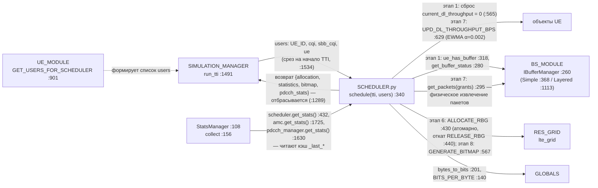
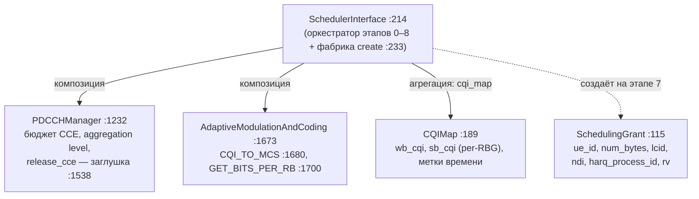
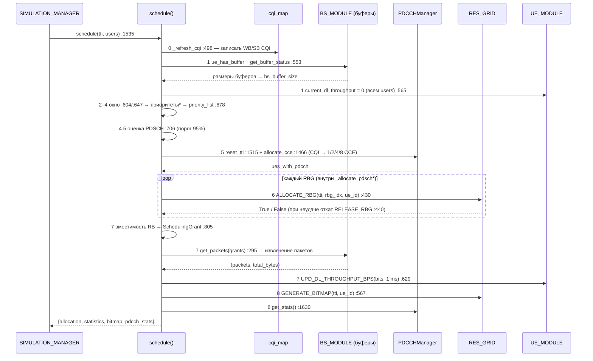
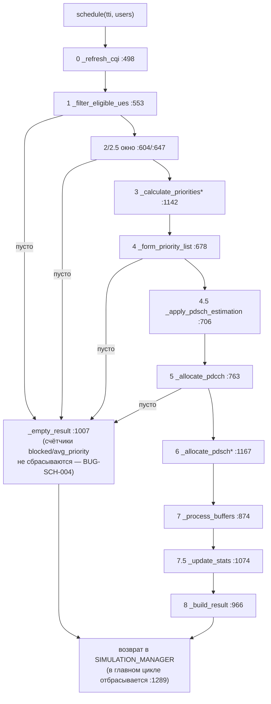
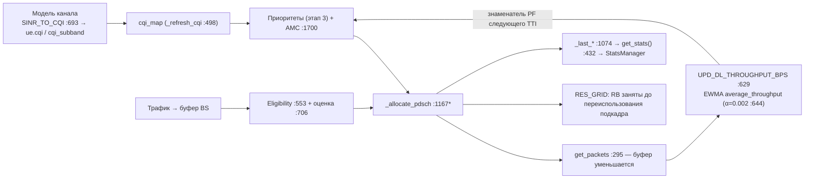
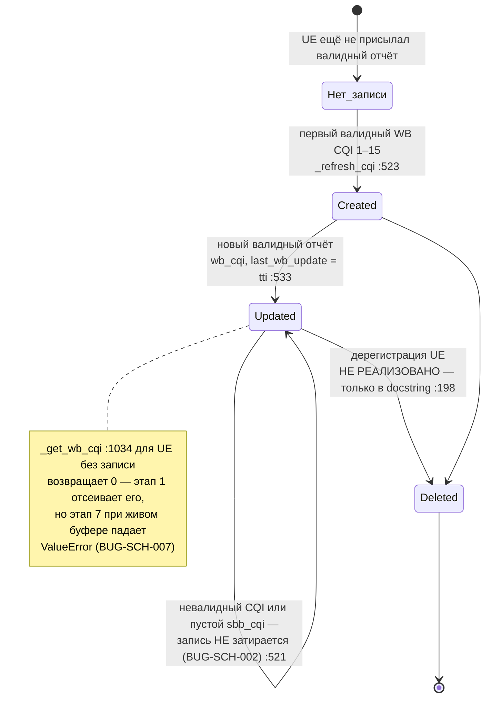
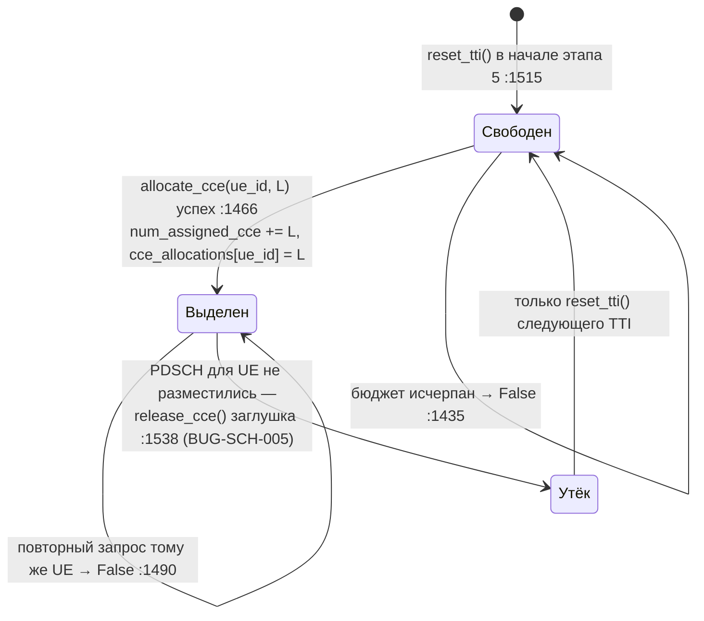
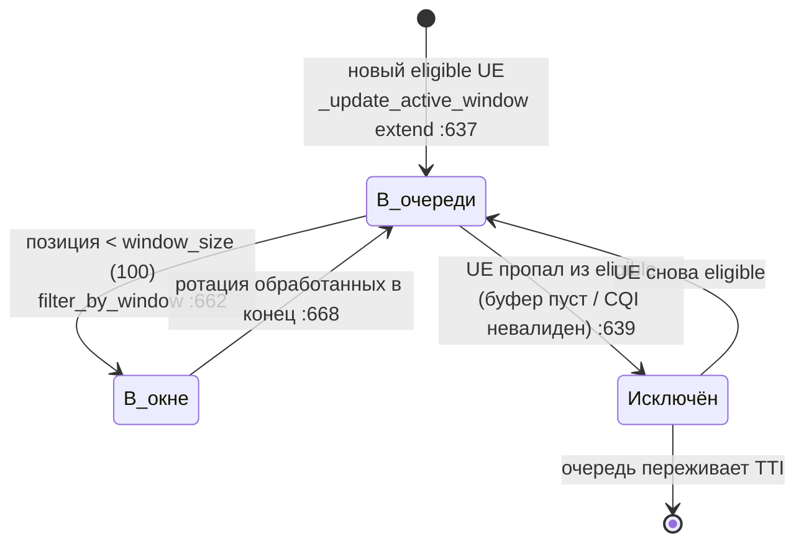
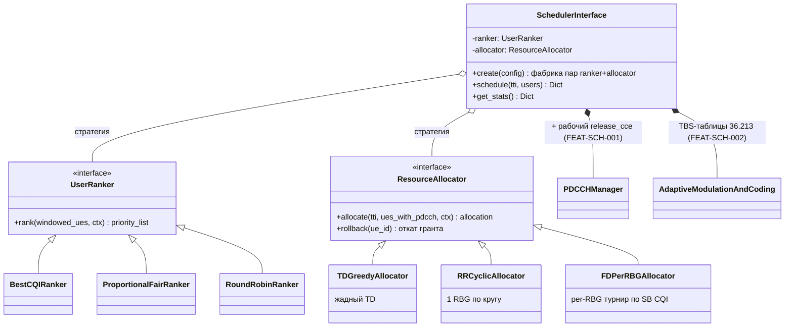

# Диаграммы модуля SCHEDULER.py

> Ответственный: Тимур (Scheduler) | Проверено по коду: `ae9db40` (ветка `dev`)  
> Все схемы соответствуют коммиту `ae9db40`; поведение подтверждено чтением кода и фактическими прогонами (сценарий TTI 5 из [README §4](../README.md), pytest). Наблюдения, упомянутые на схемах (BUG/OPT/DOC-SCH-xxx), — в [audit.md](audit.md); планируемые изменения (FEAT/OPT-SCH-xxx) — в [features.md](features.md).

## 1. Текущая структура (AS-IS)

Кратко: показаны границы модуля, его внутренний состав и структура классов; каждое соединение подтверждено кодом (ссылки в §4) и прогоном сценария TTI 5.

### 1.1. Контекст модуля: границы и побочные эффекты

### 1.2. Внутренний состав модуля

### 1.3. UML классов

```mermaid
classDiagram
    class SchedulerInterface {
        +lte_grid
        +amc
        +pdcch_manager
        +cqi_map
        +create(algorithm, lte_grid, bs)
        +schedule(tti, users) Dict
        +get_stats() Dict
        #_refresh_cqi()
        #_filter_eligible_ues()
        #_update_active_window()
        #filter_by_window()
        #_form_priority_list()
        #_apply_pdsch_estimation()
        #_allocate_pdcch()
        #_logical_channel_multiplexing()
        #_process_buffers()
        #_calculate_priorities()*
        #_allocate_pdsch()*
    }
    class BestCQIScheduler {
        #_calculate_priorities() priority = WB CQI
        #_allocate_pdsch() жадный TD
    }
    class RoundRobinScheduler {
        +rr_rbg_offset
        +rr_ue_offset
        #_calculate_priorities() ротация очереди
        #_apply_pdsch_estimation() pass-through
        #_allocate_pdsch() 1 RBG по кругу
    }
    class ProportionalFairScheduler {
        #_calculate_priorities() r/R
        #_allocate_pdsch() жадный TD
    }
    class FDxBestCQIScheduler {
        #_allocate_pdsch() per-RBG max SB CQI
    }
    class FDxFairGreedyScheduler {
        +rr_rbg_offset
        +rr_ue_offset
        #_allocate_pdsch() per-RBG + served_in_round
    }
    class FDxProportionalFairScheduler {
        #_allocate_pdsch() per-RBG PF по SB CQI
    }
    class PDCCHManager {
        +total_cce
        +max_dl_cce
        +num_assigned_cce
        +get_aggregation_level(cqi)
        +allocate_cce(ue_id, n)
        +reset_tti()
        +release_cce(ue_id) заглушка
        +get_stats()
    }
    class AdaptiveModulationAndCoding {
        +CQI_TO_MCS
        +GET_BITS_PER_RB(cqi)
        +get_stats()
    }
    class CQIMap {
        +wb_cqi
        +sb_cqi
        +last_wb_update
        +last_sb_update
    }
    class SchedulingGrant {
        +ue_id
        +num_bytes
        +lcid
        +ndi
        +rv
        +to_dict()
    }
    SchedulerInterface <|-- BestCQIScheduler
    SchedulerInterface <|-- RoundRobinScheduler
    SchedulerInterface <|-- ProportionalFairScheduler
    SchedulerInterface <|-- FDxBestCQIScheduler
    SchedulerInterface <|-- FDxFairGreedyScheduler
    SchedulerInterface <|-- FDxProportionalFairScheduler
    SchedulerInterface *-- PDCCHManager
    SchedulerInterface *-- AdaptiveModulationAndCoding
    SchedulerInterface o-- CQIMap : cqi_map
    SchedulerInterface ..> SchedulingGrant : создаёт на этапе 7
```

## 2. Типовой сценарий (AS-IS)

Сценарий: один TTI — вызов `schedule(tti, users)` из `SIMULATION_MANAGER.run_tti()`, включая все выходы за границы модуля. Порядок этапов подтверждён кодом :340–430 и прогоном ([README §4](../README.md)).

### 2.1. Последовательность вызовов

Звёздочкой помечены виртуальные методы — две точки расхождения шести алгоритмов (`_calculate_priorities` :1142, `_allocate_pdsch` :1167).

### 2.2. Досрочные выходы (dataflow с ветвлениями)

### 2.3. Контур обратной связи между TTI

Проверен замером: заранее выставленный `average_throughput` = 1 000 000 у незапланированного UE затухает до 996 004 за один TTI — двойной нулевой шаг EWMA ([audit.md](audit.md), BUG-SCH-001).

### 2.4. Переходы состояний: жизненный цикл записи CQIMap (на UE)

Заявленный в docstring `CQIMap` (:195–199) жизненный цикл против фактического поведения кода:

### 2.5. Переходы состояний: бюджет CCE в пределах одного TTI (PDCCHManager)

### 2.6. Переходы состояний: UE в скользящем окне (`_ue_queue`)

## 3. Целевая структура (TO-BE) — только если согласована

Не согласовано, см. [features.md](features.md) (OPT-SCH-001). Направление «разделить ранжирование пользователей и аллокацию ресурсов» следует из roadmap модуля (:2676–2694) и наблюдаемого дублирования механики аллокации в шести `_allocate_pdsch`; ниже — черновик схемы, шаги и приёмка описаны в OPT-SCH-001.

Что изменится относительно AS-IS: общая механика аллокации (`remaining_buffer`, вызов `ALLOCATE_RBG`, сборка индексов RB, условия прерывания), продублированная сейчас в шести `_allocate_pdsch`, уходит в иерархию `ResourceAllocator`; выбор UE — в иерархию `UserRanker`; базовый класс остаётся оркестратором этапов. Старые имена фабрики (`'BestCQI'`, `'FD_PF'`, …) сохраняются как пары (ranker, allocator) для обратной совместимости с `SchedulerConfig` (SIMULATION_MANAGER.py:871). В ту же схему без изменения оркестратора встраиваются: QoS-планировщики из открытого PR #39 (`QosAwareScheduler` — ещё один Ranker), DRL-ранжирование из ветки `feature/drl-scheduler` (PPO/DQN-ranker), венгерский бенчмарк (FEAT-SCH-004 — офлайн эталонный Allocator).

## 4. Ссылки на исходники

- `PyScheduler/SCHEDULER.py::SchedulerInterface.schedule` (:340–430) — порядок этапов 0–8, досрочные выходы через `_empty_result` (:1007)
- `PyScheduler/SCHEDULER.py::SchedulerInterface.create` (:233) — фабрика шести алгоритмов
- `PyScheduler/SCHEDULER.py::_refresh_cqi` (:498, SB-часть :540) — поведение карты CQI, невалидные отчёты игнорируются
- `PyScheduler/SCHEDULER.py::PDCCHManager.allocate_cce/release_cce/reset_tti` (:1466/:1538/:1515) — учёт CCE и заглушка освобождения
- `PyScheduler/SCHEDULER.py::AdaptiveModulationAndCoding.GET_BITS_PER_RB` (:1700) — CQI → биты/RB, TODO TBS-таблиц :1718
- `PyScheduler/SIMULATION_MANAGER.py::run_tti` (:1491), создание планировщика (:1196), `SchedulerConfig` (:871), отброшенный результат (:1289), `StatsManager` (:108, collect :156)
- `PyScheduler/UE_MODULE.py::GET_USERS_FOR_SCHEDULER` (:901–919) — контракт входа `users`, ключ `sbb_cqi` (:915)
- `PyScheduler/UE_MODULE.py::UPD_DL_THROUGHPUT_BPS` (:629, EWMA α=0.002 :644), `SINR_TO_CQI` (:693, клампит 1–15)
- `PyScheduler/BS_MODULE.py::IBufferManager` (:260; get_buffer_status :280, get_packets :295, ue_has_buffer :318), `LayeredBufferManager` (:1113), `BaseStation.use_simple_buffer` (:1439)
- `PyScheduler/RES_GRID.py::ALLOCATE_RBG/RELEASE_RBG/GET_RBG_INDICES/GET_RBG_SIZE/GENERATE_BITMAP` (:430/:440/:424/:421/:567), `BANDWIDTH_TO_RB` (:283), `RBG_SIZE_TABLE` (:293)
- `PyScheduler/GLOBALS.py::bytes_to_bits` (:201), `BITS_PER_BYTE` (:140)

Правила: схемы хранить **текстом Mermaid** в Markdown; AS-IS и TO-BE не смешивать; не рисовать каждую функцию; схема должна соответствовать конкретному коммиту.
